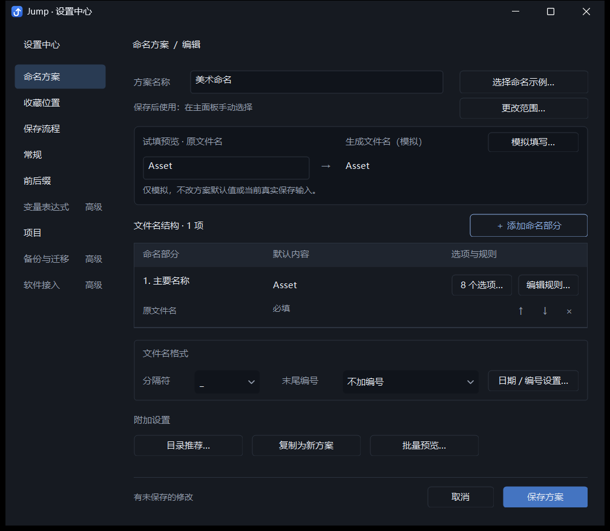
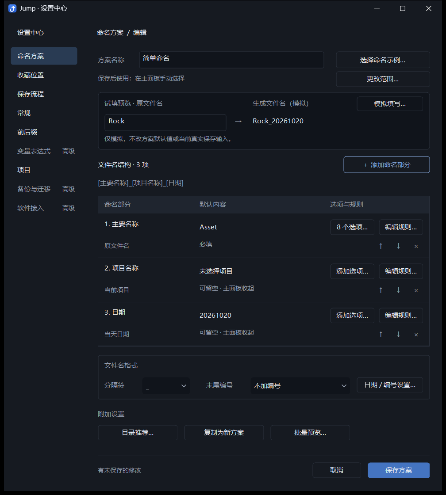
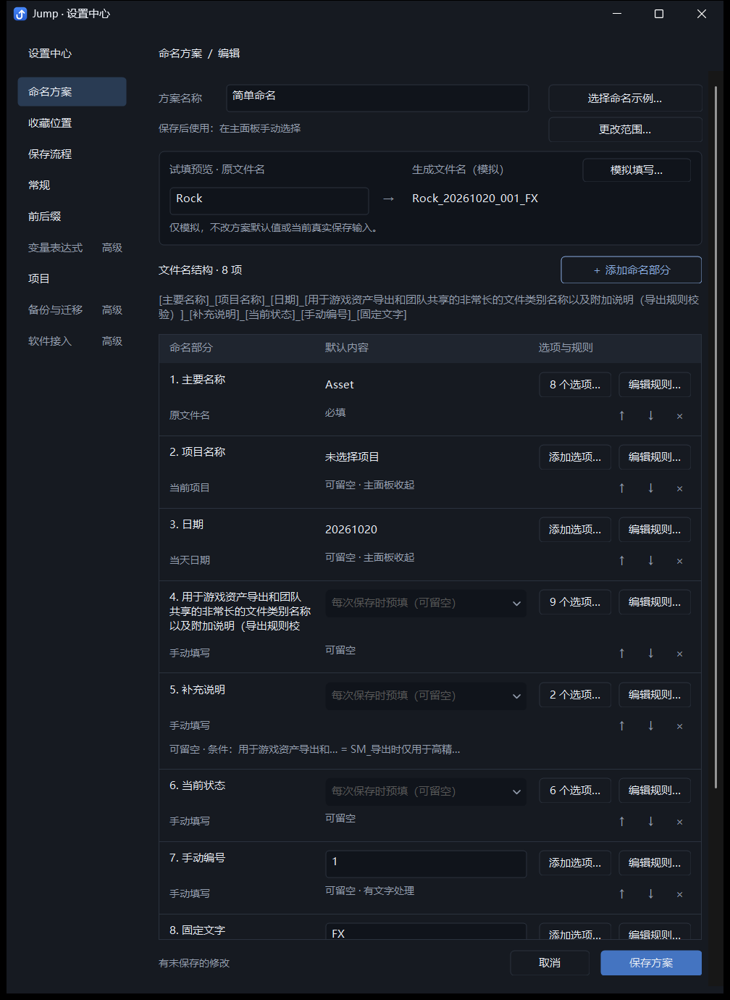
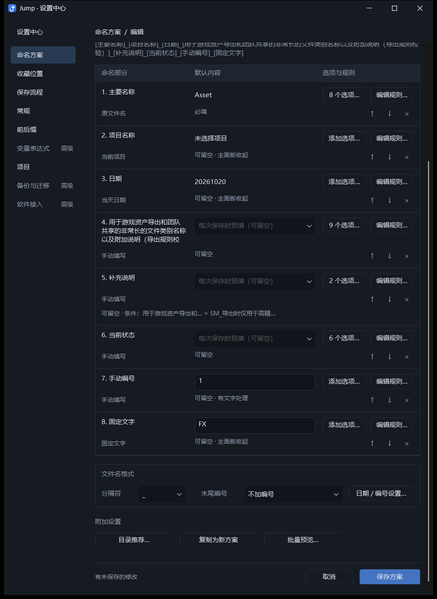
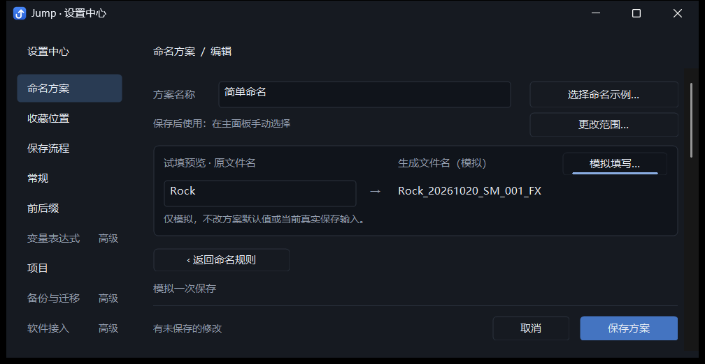
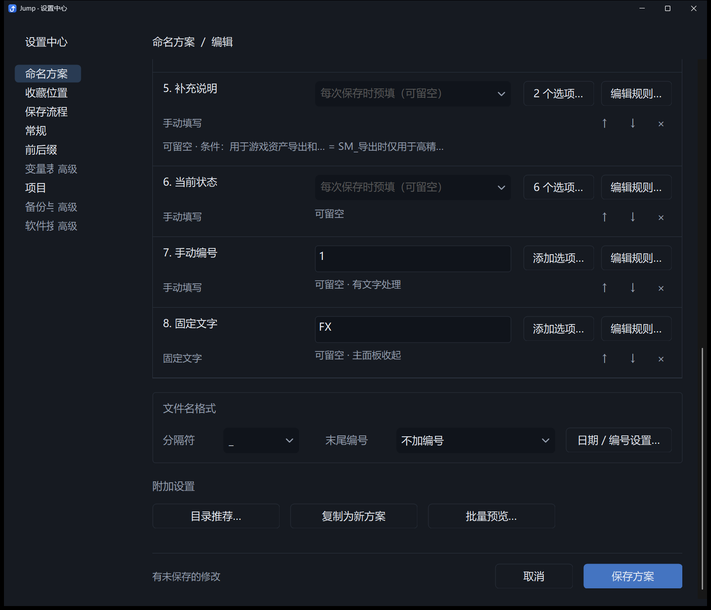
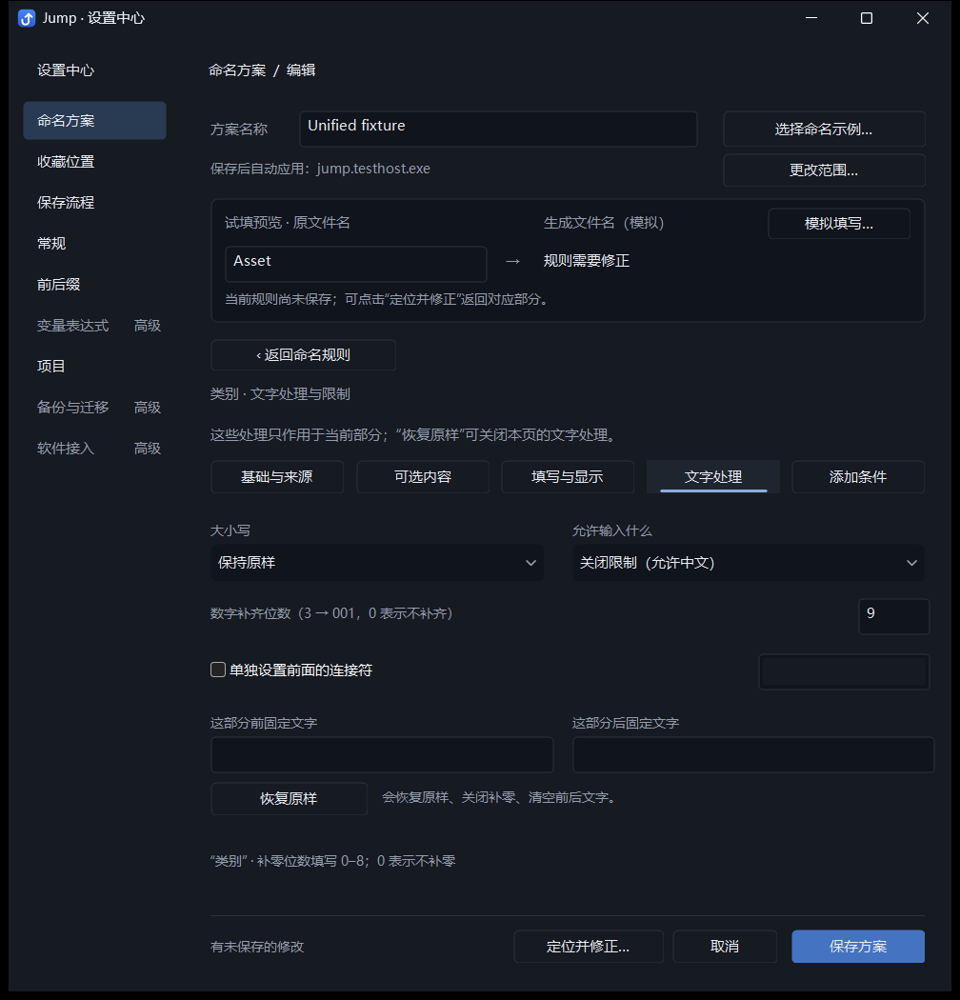

# Jump 命名方案编辑器：默认内容、试填与固定保存区

2026-10-20。本稿接续上一份表格布局评审稿，记录用户同意的五项优化。所有图均来自实际开发版和独立测试配置。旧版截图保留作历史参考，本稿代表这次修改。

## 五项调整

| 问题 | 现在的行为 |
| --- | --- |
| 默认设置与临时试填难以区分 | 总览列名改为“默认内容”，空输入提示“每次保存时预填（可留空）”；顶部明确标注“试填预览”，保留模拟边界说明 |
| 来源文字重复 | 原名、项目、日期改为简短来源标签，内容列显示实际来源内容，项目不可用时显示“未选择项目”；原文件名取进入编辑器时的真实来源，顶部试填不会把它变成方案默认 |
| 按钮只表达数量或范围含糊 | 空选项入口改为“添加选项…”，已有选项显示“N 个选项…”；规则入口统一为“编辑规则…” |
| 多项方案必须滚到底才能保存 | 保存、取消、修改状态和错误修正入口固定在底部，正文独立滚动；错误定位与键盘焦点会停在底栏上方 |
| 条件摘要占据大段空间 | 使用“条件：部分名称 = 输出文字”，超长名称和输出值分别缩略；完整规则保留悬停说明和详情编辑 |

新方案初始显示“新方案尚未保存”；已有方案初始显示“尚无修改”。规则、默认内容、常用选项、目录、软件关联和全局默认等修改参与比较。恢复原值后清除修改状态；试填原名、模拟覆盖值和批量试填不参与比较。状态提示不增加额外确认步骤，保存取消仍使用现有语义。

## 固定底栏如何保持可用

底栏高度为 52 个逻辑像素。它使用独立的不透明背景覆盖滚动正文，所有控件仍保留现有 ID 和父窗口，避免改动既有命令与存取逻辑。键盘顺序循环经过正文、错误修正（有错误时）、取消、保存，再返回方案名称；初始焦点仍在名称。

设置宿主仅对声明了固定底栏的编辑器扣除这段可视高度；其他设置页沿用原有滚动方式。缩小窗口、滚动、DPI 切换及错误修正都更新底栏位置。窗口导出截图按正文和底栏分开绘制，避免原生控件打印时绕过裁切。

## 功能边界

本轮未修改生产命名算法、配置格式或保存模型。命名来源、选项显示名称与写入文字、关键词及颜色、默认值、启用与必填、主面板显示、条件及引用同步、文字处理、日期、手动和自动编号、目录推荐、软件关联及全局默认、示例独立草稿、复制、批量预览和统一保存取消全部沿用现有能力。完整入口对照见上一份 `naming-editor-table-layout-2026-10-20.md`。

主要改动在 `src/naming_designer.h`、`src/naming_designer_layout.h`、`src/naming_designer_preview.h`；固定底栏的可选宿主支持位于 `src/settings_host.h`、`src/settings_center.h` 和 `src/main.cpp`。README 已同步更新。

## 验证

使用 `dev.ps1 -Mode Background` 构建 Debug，停止开发实例后串行运行：

```powershell
python -X utf8 tests/run_checks.py --foreground --only scheme_tasks_layout_integration.py unified_scheme_integration.py settings_center_integration.py default_schemes_integration.py
```

| 检查 | 通过组数 | 最终报告目录 |
| --- | --- | --- |
| `scheme_tasks_layout_integration.py` | 6 | `tests/output/scheme-task-layout/e1d53a19d4` |
| `unified_scheme_integration.py` | 15 | `tests/output/unified-scheme/7baaad5ef6` |
| `settings_center_integration.py` | 8 | `tests/output/settings-center/7b5713e97a` |
| `default_schemes_integration.py` | 3 | `tests/output/default-schemes/bad81c841f` |

共 32 组全部通过。

本轮新增：固定底栏位置及遮挡层检查、取消到保存再到名称的键盘顺序、缩小窗口和 100% / 150% / 200% / 本机 DPI、长条件摘要仍可完整编辑、规则撤回恢复修改状态、模拟输入不标记草稿修改、使用范围变更和撤回。继续验证统一保存取消、真实保存输入隔离、保存重启、引用同步、目录推荐和软件默认，并通过项目自有保存对话框实际生成目标文件。

开发配置继续保留，没有打包或覆盖 `dist`。测试前后的开发配置校验值、最终源码校验值与报告副本见证据清单。高 DPI 检查使用真实窗口处理 DPI 变化消息；未进行物理跨显示器拖动与新用户任务耗时测试。

## 实际截图

### 单项加八个选项



### 三项：自动来源直接显示当前内容



### 八项：正文滚动，保存区保持固定





### 小窗口与 200% DPI





### 错误修正入口也固定在底部


