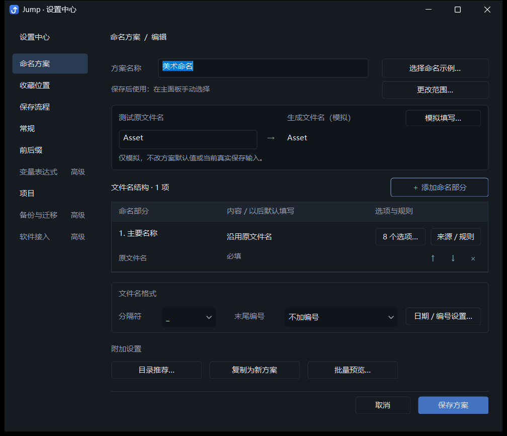
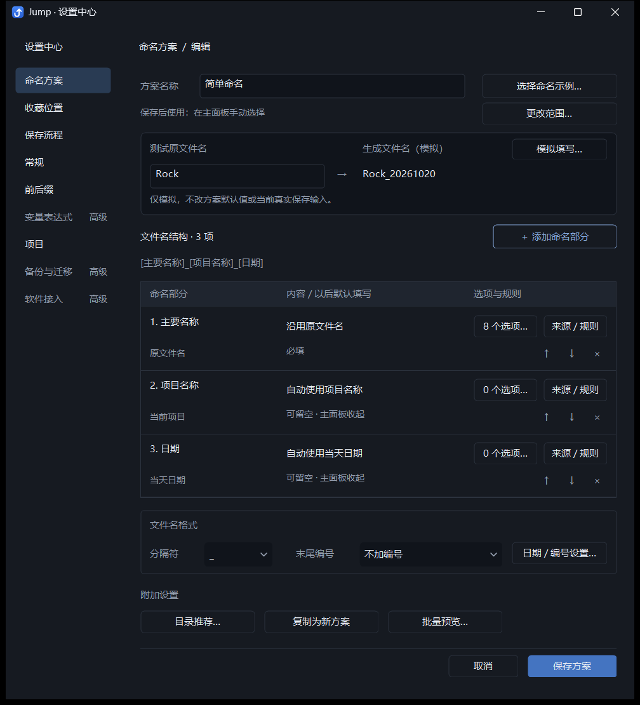
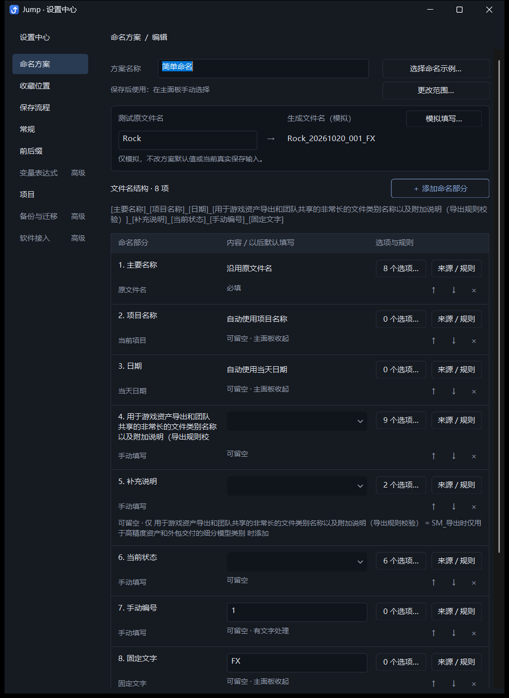
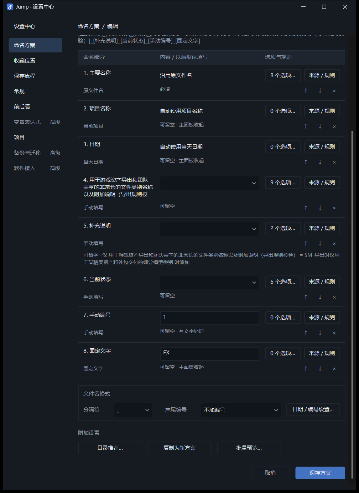
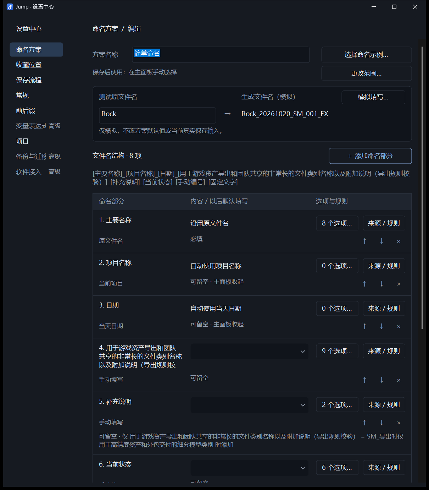
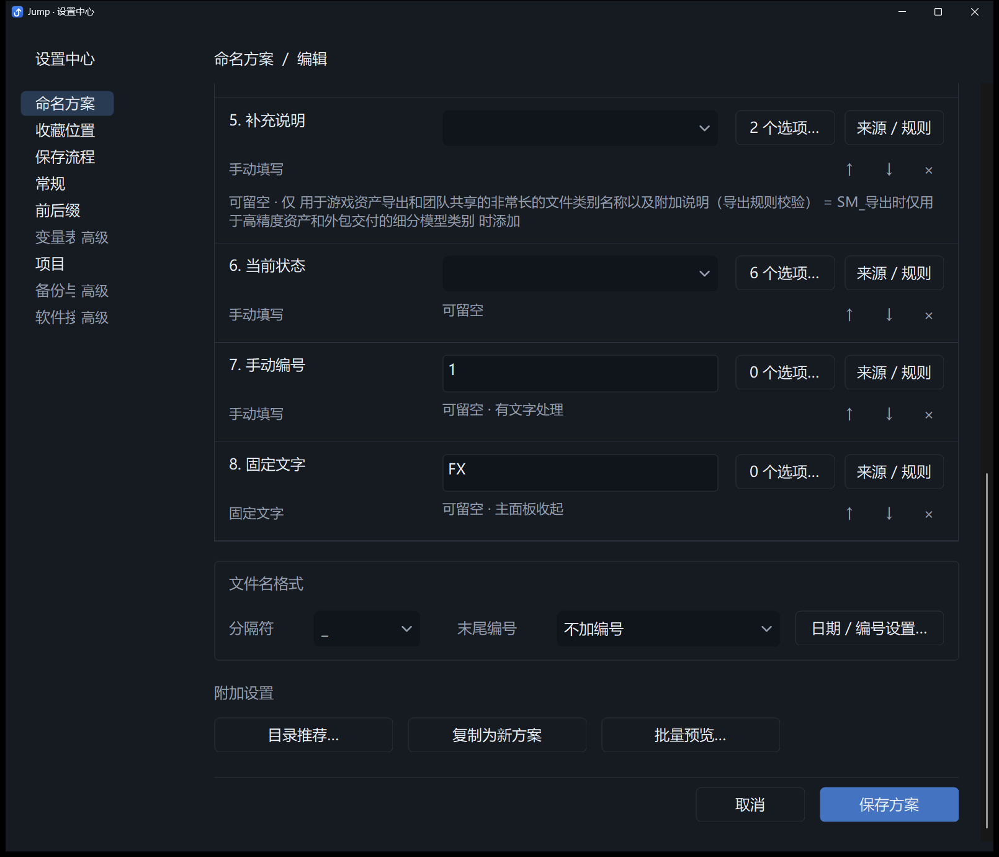
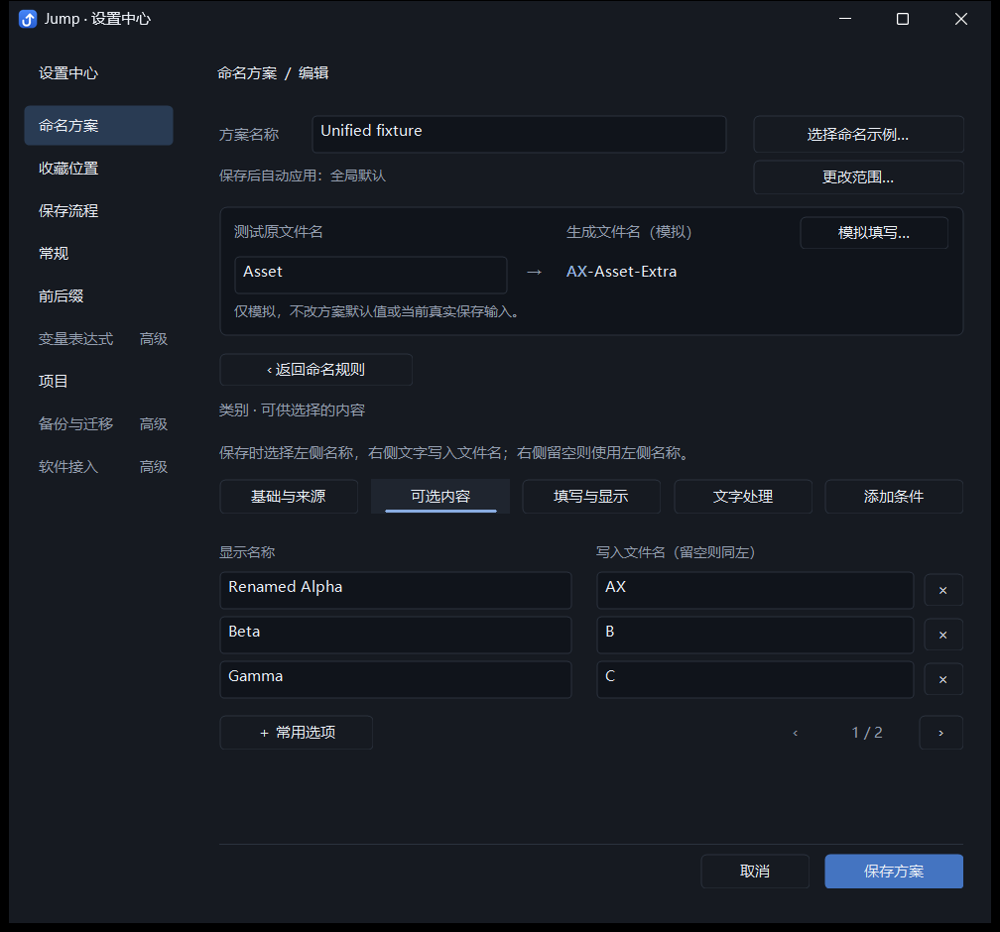
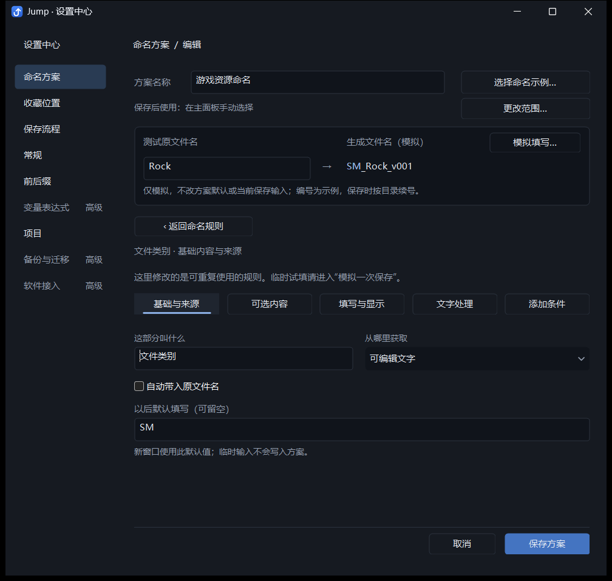
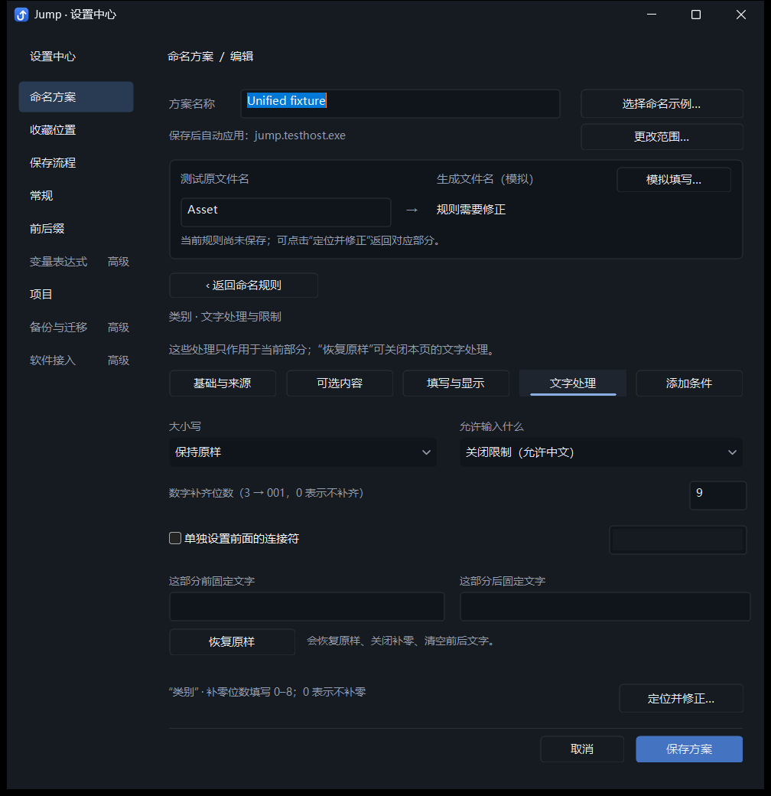

# Jump 命名方案编辑器：表格布局评审稿

日期：2026-10-20。本稿记录用户指出上一版界面混乱之后的再次修改。截图来自实际 Win32 开发版和独立测试配置。上一份 `naming-editor-visual-hierarchy-2026-10-20.md` 保留为历史记录；本稿及附图代表此次交付。

## 页面如何使用

页面依次呈现方案信息、生成预览、文件名结构、附加设置和保存操作。所有区域仍共用一份方案草稿；只有“保存方案”提交配置，“取消”一起放弃修改。

| 区域 | 直接可见的操作 | 信息组织 |
| --- | --- | --- |
| 方案信息 | 方案名称、选择命名示例、更改范围 | 保存后的自动应用或手动选择状态紧邻名称，软件关联入口固定在右侧 |
| 生成预览 | 测试原文件名 → 生成文件名（模拟） | 输入和结果横向对照；模拟填写入口位于结果上方；边界说明保留一行 |
| 文件名结构 | 添加命名部分、默认内容、选项、来源 / 规则、排序与删除 | 统一表头和列宽，每项形成完整编辑行；多项显示拼接概览，单项省去重复概览 |
| 文件名格式 | 分隔符、末尾编号、日期 / 编号设置 | 作为结构末尾的独立小组，避免格式规则混在添加操作中 |
| 附加设置 | 目录推荐、复制为新方案、批量预览 | 低频操作集中为次级按钮；详情中移除重复的批量预览入口 |
| 保存操作 | 取消、保存方案 | 与编辑区分隔；只有保存使用主要填色按钮 |

常用默认内容可以在总览直接输入。每行右侧固定显示“N 个选项…”和“来源 / 规则”，不需要通过通用菜单寻找。行右下角是向前、向后及删除操作；不能执行时禁用。来源和必填、停用、隐藏、文字处理、条件摘要属于各自这一行。

自动内容显示沿用原文件名、自动使用当前项目或当天日期；手动内容显示默认输入框，已有可选内容时保留下拉选择和自由输入。总览输入修改以后使用的默认值，顶部的测试输入只用于模拟。模拟页仍可临时覆盖各部分并查看解释。

高级设置沿用已有五个任务：基础与来源、可选内容、填写与显示、文字处理、添加条件。返回入口现在是普通按钮，不再同时显示两个返回入口或把返回操作绘制成选中的标签页。

## 此次实际修正

- 把分散的三行文字操作改为有表头的编辑表格，固定名称、默认内容、选项和规则的位置。
- 用边框组织模拟区和格式区，用细横线区分命名部分；减少同级蓝色文字入口。
- “添加命名部分”固定在结构标题右侧，使用强调边框；示例、范围及其他工具使用普通次级按钮。
- 单项不再显示重复的组成串，保存区之前减少 34 个逻辑像素空白。
- 修复表头重布局后的背景残影；修复可编辑下拉框在字体 / DPI 改变后文字高度不足，以及非焦点状态下蓝色选区遮住分隔符的问题。
- 移除详情页重复的批量预览按钮，避免它挤入错误提示和保存区域；总览入口及批量预览能力完整保留。

## 多项、长文字与 DPI

普通行沿用相同列宽。名称根据字体实际测量，最多分配三行；复杂状态摘要移到跨列区域，最多两行；组成概览最多两行。完整名称和规则保留悬停说明，详情中可以查看和编辑。行高随文字变化，后续行和格式区域跟随下移。

3～8 项使用相同操作尺寸，通过窗口滚动访问后续内容。缩小窗口及错误修正时，焦点跟随滚动到可见输入。高 DPI 检查包含 100%、150%、200% 和本机 DPI 的变化消息；这是实际窗口重布局截图，尚未验证物理跨显示器拖动。

## 功能和语义保留

| 能力 | 当前入口及边界 |
| --- | --- |
| 原名、手动内容、项目、日期、固定文字来源 | 每行来源摘要和“来源 / 规则 → 基础与来源”；原名可带扩展名 |
| 常用选项与默认值 | 每行选项入口，默认内容直接编辑；选项显示名称和写入文字可以不同，保留关键词与颜色 |
| 必填、启用、主面板显示 | “填写与显示”；停用保留规则，隐藏输入不等于停用 |
| 条件显示 | “添加条件”；按其他部分写入文字判断，保留引用更新、循环检查和错误定位 |
| 文本处理 | “文字处理”；大小写、输入限制、补零、独立连接符、前后固定文字和恢复原样 |
| 手动及自动编号 | 手动编号仍为可编辑数字部分；末尾版本 / 序号在格式区，真实自动续号按目标目录计算 |
| 日期和分隔符 | 格式区；分隔符支持空值、自定义文字及预设下拉选项 |
| 目录推荐 | 附加设置；匹配输出内容，用户点击推荐才切换目录 |
| 软件关联、全局默认 | 顶部“更改范围”；软件专用优先，再跟随全局默认，临时切换不改默认 |
| 模拟及批量预览 | 顶部“模拟填写”和附加设置“批量预览”；临时输入不写方案默认或真实保存输入 |
| 示例与复制 | 顶部选择示例、附加设置复制；保留示例独立草稿与明确采用步骤，复制不继承软件 / 全局默认关联 |
| 统一草稿、保存与取消 | 所有现有任务共用一次提交或放弃；配置格式和生产命名算法保持原有实现 |

更完整的早期功能迁移对照见 `naming-editor-ux-refactor-2026-10-20.md`。此次未增加新的功能或页面。

## 验证与代码

通过 `dev.ps1 -Mode Background` 构建 Debug；停止开发实例后，使用项目自有 UI 夹具串行运行：

```powershell
python -X utf8 tests/run_checks.py --foreground --only scheme_tasks_layout_integration.py unified_scheme_integration.py settings_center_integration.py default_schemes_integration.py
```


| 检查 | 通过组数 | 最终报告目录 |
| --- | --- | --- |
| `scheme_tasks_layout_integration.py` | 6 | `tests/output/scheme-task-layout/163fa22a5c` |
| `unified_scheme_integration.py` | 14 | `tests/output/unified-scheme/e28267d6d0` |
| `settings_center_integration.py` | 8 | `tests/output/settings-center/57f73038e2` |
| `default_schemes_integration.py` | 3 | `tests/output/default-schemes/550970feae` |

最终报告与源码 SHA256 见同目录 `naming-editor-table-evidence-2026-10-20.json`，报告副本随评审压缩包提供。布局检查涵盖单项加八个选项、三项、八项、长名称、复杂条件、高 DPI、缩小视口、Tab 顺序、错误定位、分隔符空值 / 自定义值及批量预览。方案集成验证统一草稿、默认值和模拟隔离、关联和引用同步、保存重启，以及通过原生保存对话框实际生成 `AZ-Rock-Extra.txt` 和 `SM_Rock_v001.txt`。

主要实现文件：`src/naming_designer.h`、`src/naming_designer_layout.h`。`src/naming_designer_preview.h` 保留此前的实时模拟实现。扩展验证位于 `tests/scheme_tasks_layout_integration.py`，入口说明同步更新在 README。

开发配置 `build/dev/settings.ini` 保持原值，SHA256 为 `9298186A918885BCE9B49CD7206B8BBF36F7B8F837DA33EFC327E359CB9FA769`。使用测试配置生成截图；没有打包或覆盖 `dist`。

## 新界面截图

### 与用户场景相同：主要名称和八个选项



### 三个命名部分



### 八个命名部分、长名称和条件





### 150% 和 200% DPI





### 选项、规则详情与错误修正







## 供后续评审关注

建议下一轮评审围绕三个真实任务：看懂文件名从左到右的组成、修改某一部分的默认值或常用选项、判断测试结果与保存后的应用范围。可进一步评估首次使用时的任务完成率，以及超过三行的极端名称是否需要不同的呈现方式；不要仅凭一张单项截图判断多项操作体验。
