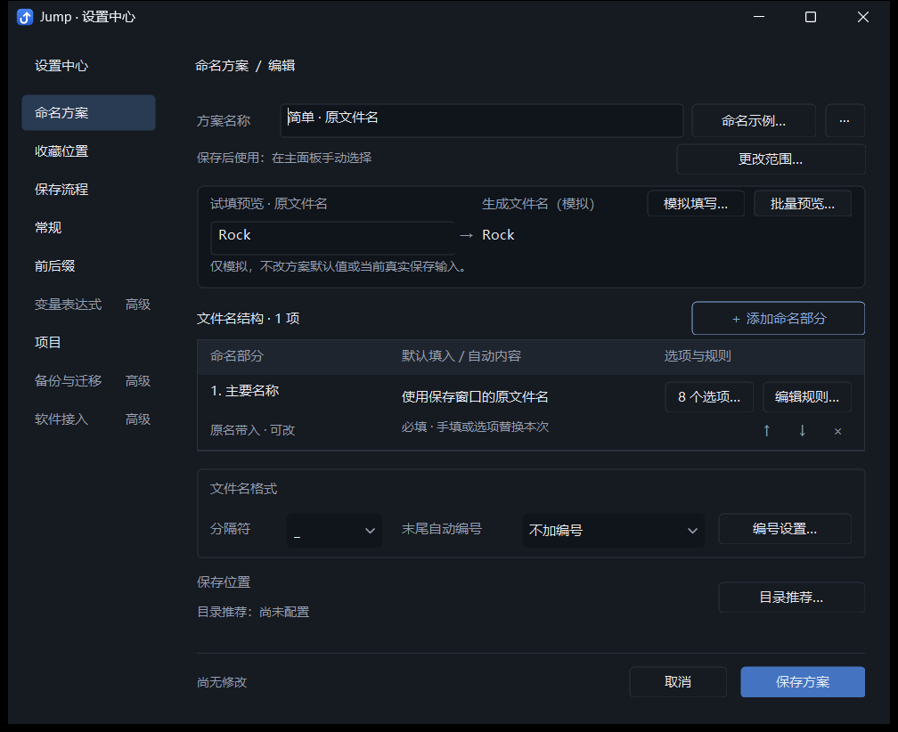
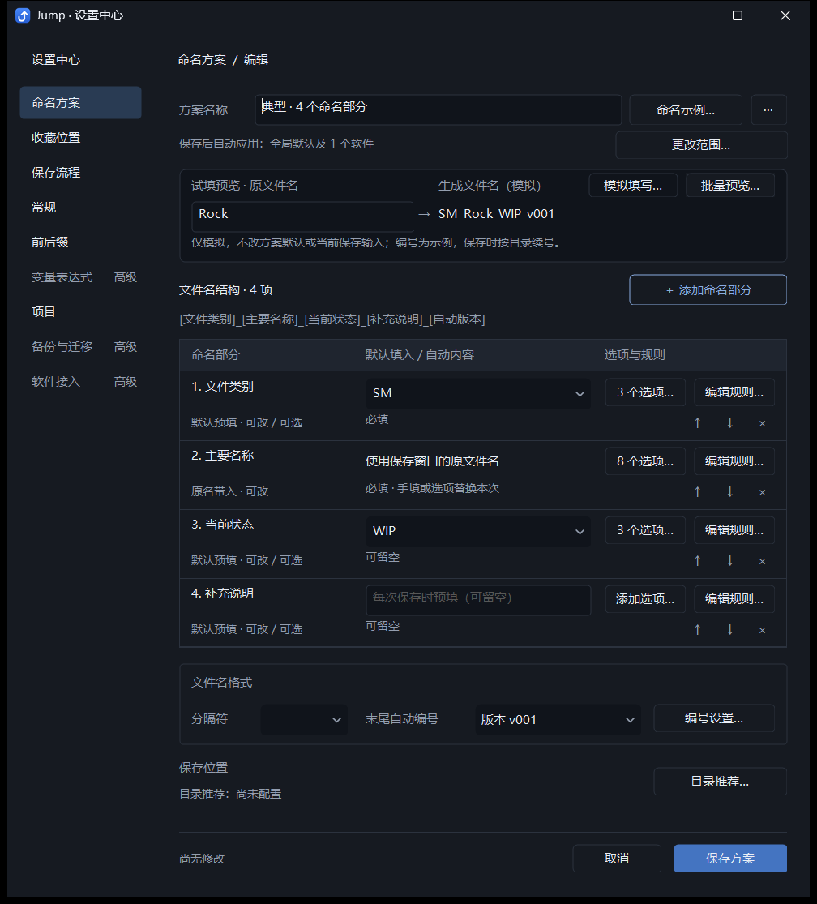
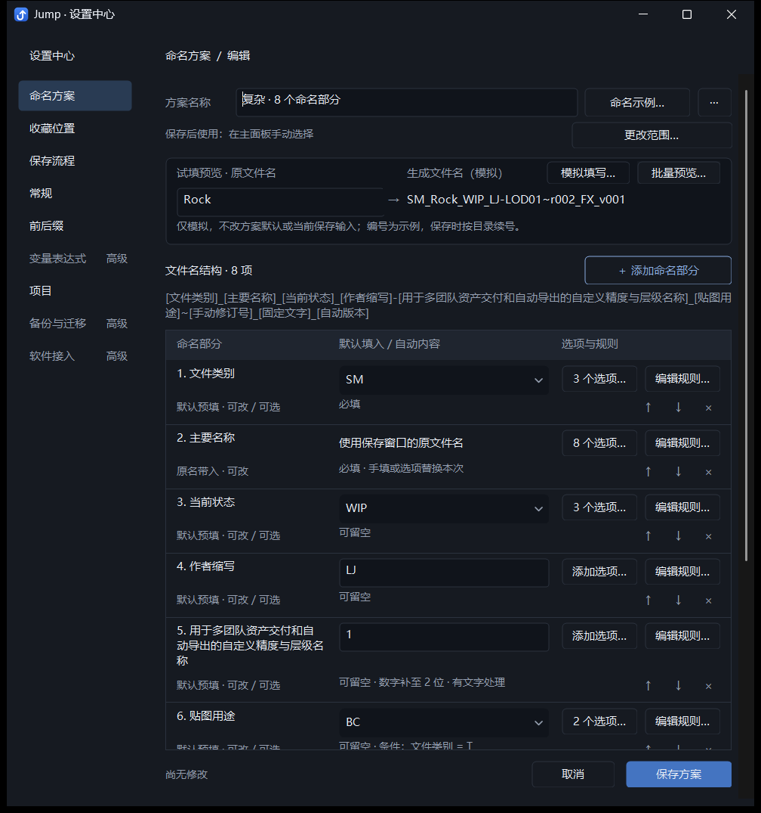
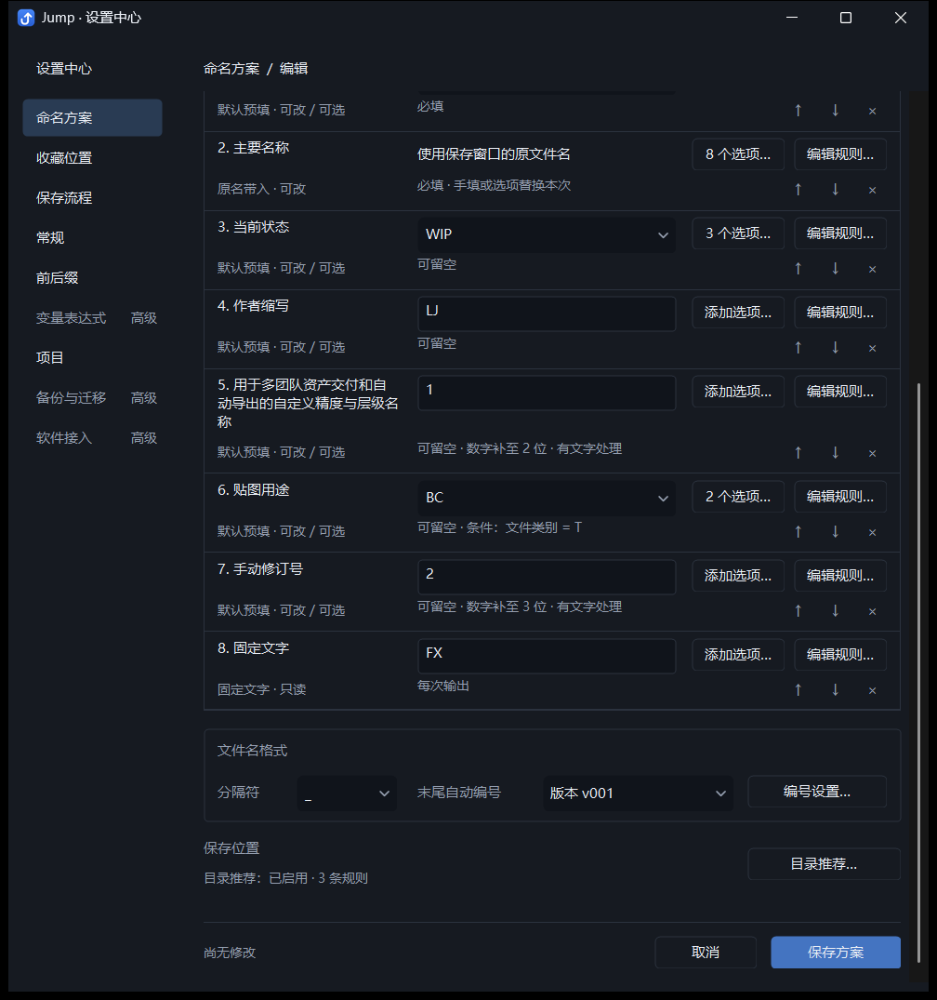
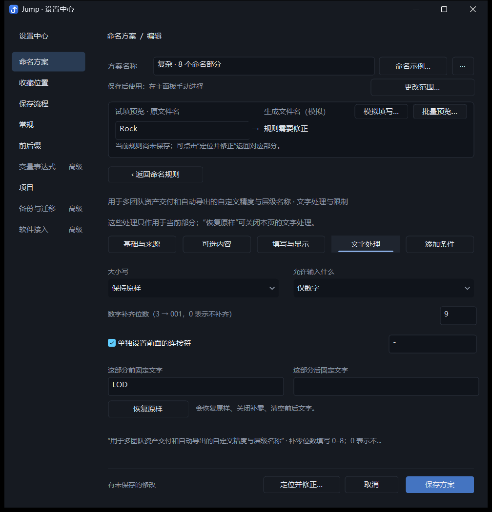
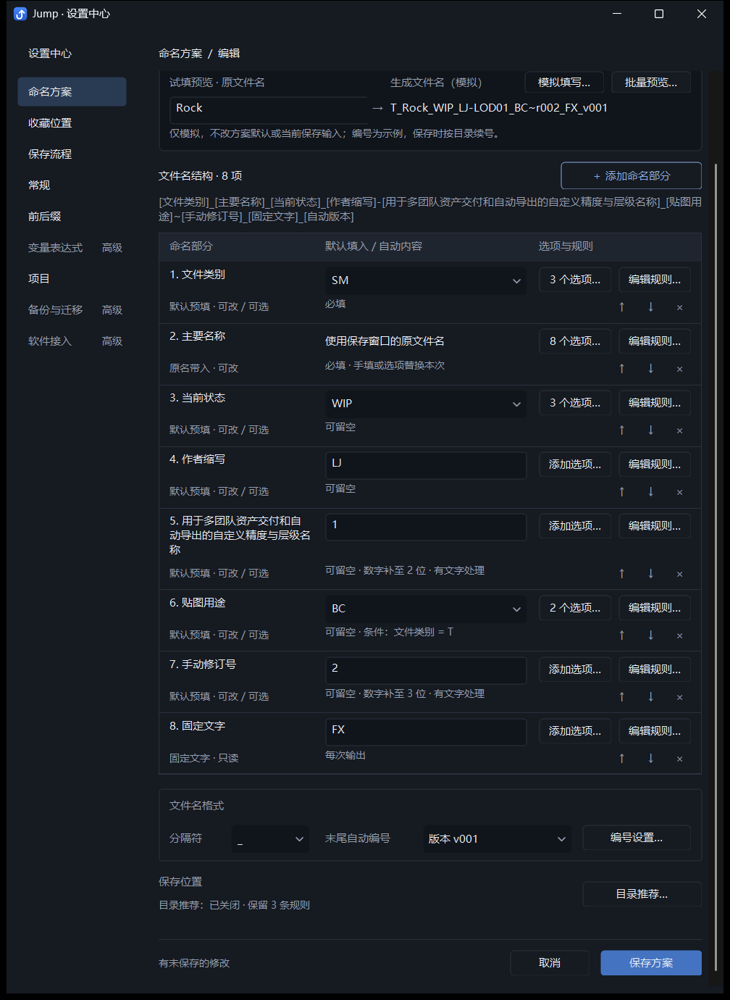

# Jump 命名方案编辑器：状态修正与使用场景验证

本轮保留现有信息架构、两行列表、预览和固定保存区，仅修正三处状态与入口表达，开始用完整任务检查使用路径。

## 本轮修改

1. **主要名称不再显示 Asset。** 管理界面初始化预览时使用 `Asset` 样例；它不是方案默认，也不是原文件名为空时的备用值。规则列表及来源详情现在显示“使用保存窗口的原文件名”，行内说明“手填或选项替换本次”。先带入原名，用户主动手填或选常用选项后替换本次内容。普通字段默认值和自动项目/日期语义均未改变。
2. **目录推荐显示实际配置状态。** 没有规则显示“目录推荐：尚未配置”；有规则且开启显示“目录推荐：已启用 · N 条规则”；关闭显示“目录推荐：已关闭 · 保留 N 条规则”。点击状态文字或原有目录推荐按钮进入规则设置。原有开关与规则保留机制不变。
3. **复制降为方案级次要操作。** 顶部保留命名示例，右侧“···”菜单包含复制为新方案；名称输入增加 66 个逻辑像素。复制仍保留完整草稿与目录规则，不继承软件关联和全局默认，最后保存才写入配置。

没有增加主导航、详情展开层、卡片或常驻说明。单项空白不填充新控件。

## 三组实际场景

| 场景 | 构成与预期结果 | 检查结果 |
| --- | --- | --- |
| 简单：1 个字段 | 原文件名 → `Rock`，附 8 个常用名称供主动替换 | 空原名提示未完成，不回退到 Asset；上下移动及删除禁用；查看选项一步进入；试填和取消不写配置 |
| 典型：4 个字段 | 类别默认 SM、原名 Rock、状态默认 WIP、可空补充说明；末尾自动版本 → `SM_Rock_WIP_v001` | 默认内容、选项名称/输出映射、编号开关均直接生效；模拟不改默认；撤回恢复干净状态；复制菜单与取消正常 |
| 复杂：8 个字段 | 类别、原名、状态、作者、自定义长名称 LOD、条件贴图用途、手动修订号、固定文字；另有末尾自动版本和 3 条目录规则 | 长名称换行；类型 SM 时省略贴图用途，T 时加入 BC；局部连接符和补零保持正确；滚动保存区固定；错误修正保留输入；关闭推荐保留 3 条规则 |

典型方案的“4 个字段”包含一个留空的补充说明。自动版本属于已有方案格式，不占 8 个字段名额；输出中可见的四段是 SM、Rock、WIP 和 v001。本轮没有为满足截图数量改变数据模型。

复杂方案示例：

```text
SM_Rock_WIP_LJ-LOD01~r002_FX_v001
T_Rock_WIP_LJ-LOD01_BC~r002_FX_v001
```

## 列表是否继续压缩

本轮保留两行。实际测得典型四项的行间距为 68 DIP；复杂八项的常规行仍为 68 DIP，自定义长名称行约 90.4 DIP。选项和规则一直直接可见，默认内容无需展开；排序及删除保持在本行。复杂方案通过现有滚动访问下部，固定底栏始终可用。

这些证据支持先保留当前列表，并不证明新用户已经能无指导完成所有任务。改为单行后会增加详情进入或挤压长名称，本轮没有足够的真实用户收益证据，因此没有实施。

## 自动化验证

通过 `dev.ps1` 构建 Debug，串行运行自有窗口集成检查，未更新 `dist`。相关报告副本在同目录素材文件夹的 `reports` 内，证据清单记录源码、程序、截图和开发配置 SHA256。

| 集成检查 | 通过组数 | 报告目录 |
| --- | --- | --- |
| `scheme_usage_scenarios_integration.py` | 3 | `tests/output/scheme-usage-scenarios/76bb20a91d` |
| `scheme_tasks_layout_integration.py` | 7 | `tests/output/scheme-task-layout/b0aae65195` |
| `unified_scheme_integration.py` | 15 | `tests/output/unified-scheme/7b5c1a1795` |

共 25 组通过。

新增场景检查覆盖 1/4/8 字段、三态目录推荐、方案菜单取消/复制、禁用操作、默认修改撤回、条件与局部格式、错误恢复和全部取消不写配置。既有布局检查覆盖小窗口、100% / 150% / 200% / 本机 DPI、控件对齐、固定底栏和保存重开；统一方案检查覆盖选项/默认/条件/目录引用同步、软件关联、主面板真实输入隔离和自有保存对话框实际文件保存。开发配置与修改前一致。

这是自动化任务检查和实际截图核对，尚未进行新用户观察测试或物理跨显示器拖动测试。

## 后续真实用户验证任务

建议保持本版布局，观察新用户独立完成以下任务，记录首次误解、找错入口和是否需要提示，不预先讲解界面：

- 简单方案：把 Rock 改成 Cliff；说明该修改是否会影响下一次保存。
- 典型方案：找到默认 SM、将当前状态改成 REVIEW，再开启/关闭自动版本；解释主要名称的 8 个选项会在何时生效。
- 复杂方案：切换类别验证条件部分出现，修改 LOD 数字格式，关闭并恢复目录推荐，修正一次错误后取消；确认方案没有被写入。

先依据这些任务中的重复障碍决定是否调整列表密度；不继续按视觉偏好循环重构。

## 实际界面

### 简单方案



### 典型四项方案



### 复杂八项：顶部与底部





### 错误与关闭后的目录状态




