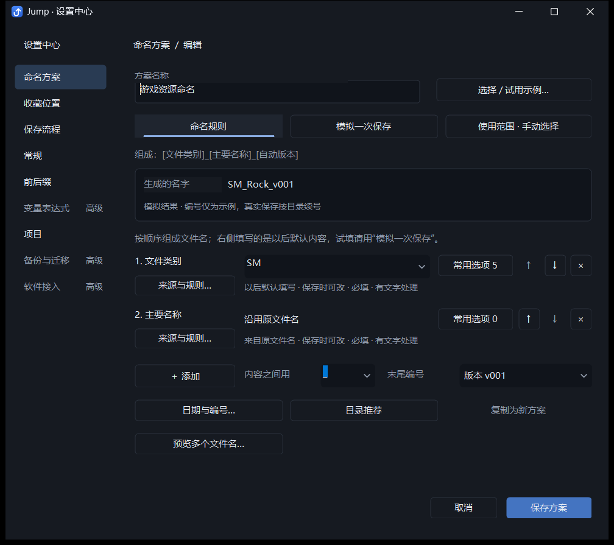
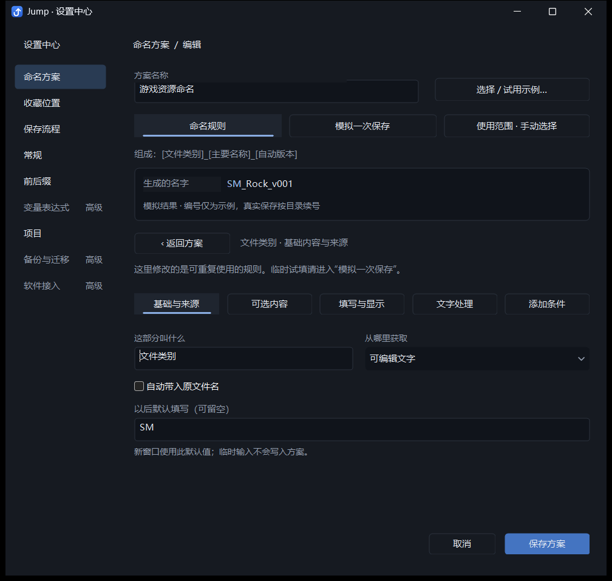
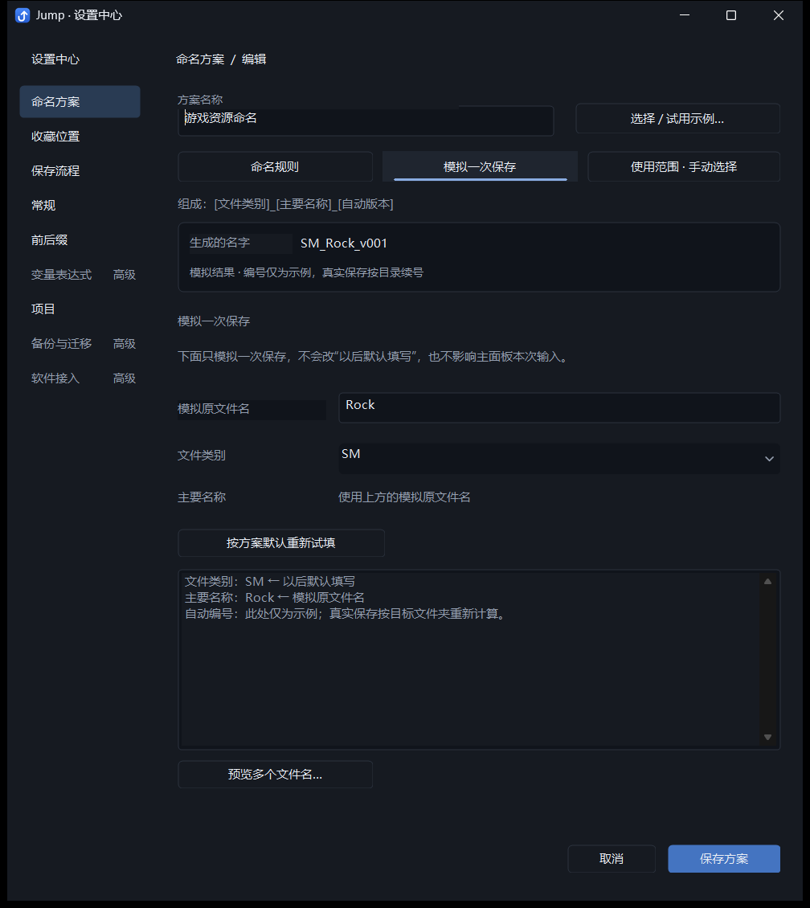
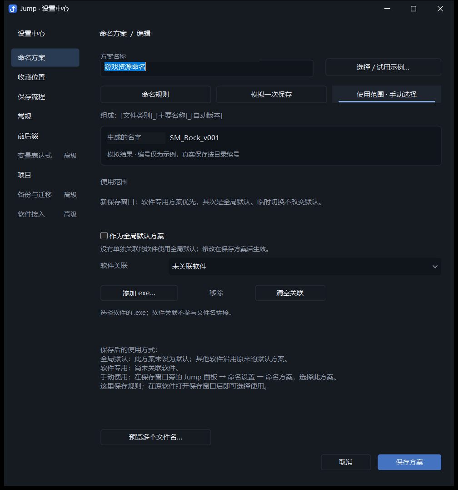
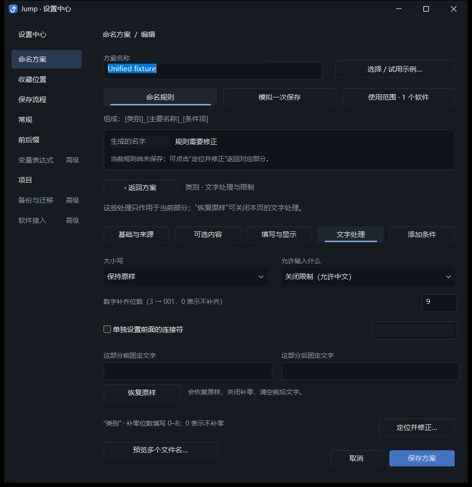
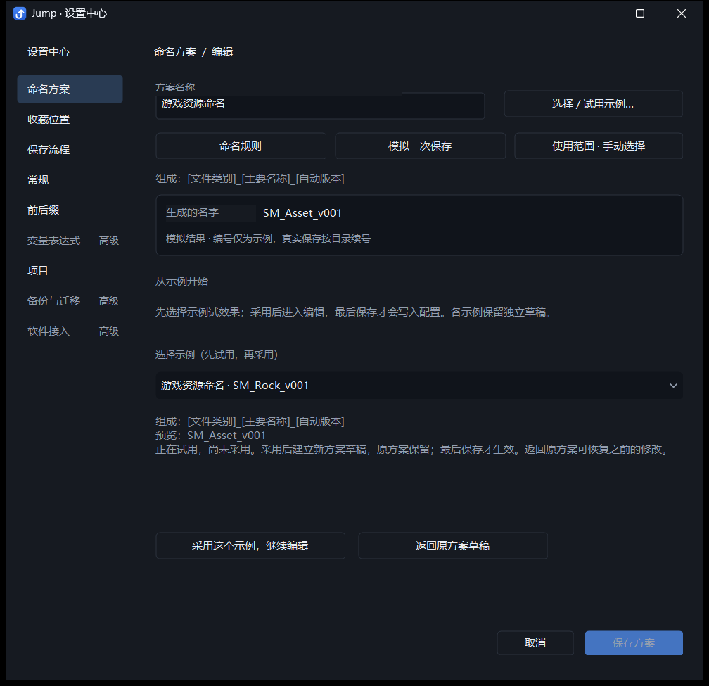

# Jump 命名方案编辑器：当前实现与优化评审文档

日期：2026-10-20。本文对应实际开发版实现；旧的 `naming-scheme-review-2026-10-20.md` 是重构前的评审材料。

用途：把本文连同配套截图交给其他 AI 或产品设计师，评估目前的方案是否容易理解，并提出下一轮优化。下文将已实现行为、自动化证据和未验证的体验假设分开；截图呈现的是现状，不要求评审沿用现有布局。

## 产品背景和问题

Jump 是原生 C++ / Win32 Windows 保存辅助工具，配合其他软件的文件保存对话框使用。保存主面板负责填写这次文件的内容、组合文件名和选择目录；设置中心的命名方案编辑器负责定义可重复使用的命名规则。最终文件格式、磁盘写入和覆盖确认由原软件负责。

典型需求是游戏美术资源命名：选择中文类别“静态模型”，输入原名 `Rock`，生成 `SM_Rock_v001`。实际方案可以使用不同的内容、分隔符、来源、编号、条件和目录推荐。

用户最初反馈：方案设置与自定义分散在不同窗口；集中以后仍然过于繁复，新用户不知道怎么用。当前实现试图让用户按“定义规则 → 模拟结果 → 决定哪里使用”理解方案。设计是否达到了这一目标，仍需要评审和真实新用户验证。

本轮集中的是命名方案。设置中心仍保留收藏位置、保存流程、常规、前后缀、变量表达式、项目、备份与迁移、软件接入等其他栏目。方案里的局部前后文字与主面板的本次临时修饰同时存在，评审时需要检查这两种概念是否容易混淆。

## 入口、页面结构和典型流程

入口包括设置中心的命名方案设置、保存主面板的命名设置，以及直接定位某项常用选项或软件关联的入口。它们进入同一编辑器，使用同一份草稿和保存逻辑。

```text
新建方案 → 选择示例 → 试用 → 明确采用
编辑已有方案 ─────────────────┐
                             ↓
命名方案编辑器（共享草稿）
├─ 命名规则
│  ├─ 组成结构、结果预览
│  ├─ 每一部分：以后默认填写 / 常用选项 / 上下移动 / 删除
│  ├─ 来源与规则：基础与来源 / 可选内容 / 填写与显示 / 文字处理 / 添加条件
│  └─ 全局分隔符 / 日期与编号 / 目录推荐 / 复制 / 多原名预览
├─ 模拟一次保存：原名、临时输入、结果和逐项输出解释
└─ 使用范围：全局默认、软件关联、手动选择说明
          ↓ 保存规则和使用范围，或取消全部修改
真实保存对话框旁的 Jump 主面板 → 填写本次内容 → 回填文件名 → 原软件保存
```

例如创建 `SM_Rock_v001`：

1. 新建，试用“游戏资源命名”，查看组成与预览，再点击“采用这个示例，继续编辑”。
2. 在命名规则中检查类别、原名和末尾版本；如有需要，打开类别的常用选项，把显示名称“静态模型”与写入文字 `SM` 对应起来。
3. 进入“模拟一次保存”，临时输入 `Rock` 和类别值，检查结果以及每项解释。编号此时是示例。
4. 在“使用范围”设为全局默认，或关联具体软件；也可以保留手动选择。
5. 保存方案。之后在真实保存主面板填写本次文件内容，自动编号根据实际目录确定。

现有方案可直接编辑，不必重新采用示例。切换任务页本身不写配置；统一保存才提交。临时切换主面板的方案不改变全局默认或软件关联。

## 交互变化和原因

编辑器现在围绕三个可直接进入的任务组织，共享同一份草稿、一次保存和取消：

1. **命名规则**：先显示组成结构和结果，再按拼接顺序显示每一部分。默认内容直接填写，常用选项、上移、下移、删除直接可见；来源与复杂规则在对应部分的详情里调整。
2. **模拟一次保存**：提供独立的原名和其他输入，不改以后默认内容，也不改主面板的本次真实输入。逐项解释输出来源，以及未填写、停用、条件不满足、项目不可用等未输出原因。
3. **使用范围**：入口直接显示全局默认、软件数量或手动选择状态。页面说明软件专用方案优先于全局默认，并给出主面板手动使用的入口。

单项详情拆为 **基础与来源 / 可选内容 / 填写与显示 / 文字处理 / 添加条件**。常用选项与添加条件不再混在一页，也不依赖逐行探索通用编辑菜单。

新建方案先展示具有输出示例的起点：简单命名、游戏资源命名、从空白创建，以及已有方案。选择只用于试用，必须明确采用才能保存；采用示例建立新方案草稿，原方案保留。可返回原方案，各示例仍保留独立草稿。采用后进入正常编辑，最后保存才写配置。

错误指出相关命名部分，并提供定位修正入口；定位不会清掉填错的文字。缩小窗口后可滚动，Tab 和修正入口会把输入带入可见区域。

## 三种数据的边界

| 数据 | 保存位置与生命周期 | 修改它的入口 |
| --- | --- | --- |
| 以后默认填写 | 方案草稿中的 `defaultValue`，最终经原有配置逻辑持久化 | 命名规则的直接输入、来源详情 |
| 本次模拟输入 | 编辑器的独立字段 ID → 临时值映射；示例各自保留，关闭后不持久化 | 模拟一次保存；按方案默认重新试填清除覆盖 |
| 本次真实保存输入 | 原有主面板会话 | 保存主面板的现有快速输入和修饰入口 |

模拟从当前方案定义建立 `namingSession`，应用临时覆盖，调用原有 `composeStructure`、`namingFieldVisible`、`namingFieldOutput` 和 `numberingExample`。没有另写命名算法，也不扫描真实目录。自动编号明确标为示例，实际保存按目标目录计算。原名带扩展名时，模拟保留扩展名；真实格式仍由原软件决定。

## 原有功能迁移对照

| 原有能力 | 现在的入口 / 保留的行为 |
| --- | --- |
| 1. 全部内容类型、1～8 项 | 命名规则 → 添加；每行 ↑ / ↓ / ×。主要名称、项目、日期、类别、说明、状态、手动编号、固定文字、自定义内容全部保留 |
| 2. 默认与固定、原名、项目、日期来源 | 每行直接默认输入；来源与规则 → 基础与来源 |
| 3. 原名接收项唯一 | 基础与来源 → 自动带入原文件名；沿用原有唯一映射 |
| 4. 名称与写入文字分离，关键词与颜色 | 每行常用选项 → 可选内容；原有选项结构、引用同步和颜色数据继续使用 |
| 5. 必填、参与命名、主面板可见性 | 来源与规则 → 填写与显示；三个独立开关 |
| 6. 大小写、限制、补零、局部连接及前后文字 | 来源与规则 → 文字处理；保留恢复原样 |
| 7. 条件与循环校验 | 来源与规则 → 添加条件；按另一部分写入文字匹配，循环阻止保存并可定位修正 |
| 8. 全局分隔符，含空值 | 命名规则下方直接输入；留空直接连接 |
| 9. 日期格式 | 命名规则 → 日期与编号 |
| 10. 手动与自动编号独立 | 添加 → 手动编号；末尾编号直接选择或日期与编号中调整 |
| 11. 位数、版本大小写、同名检查 | 日期与编号 |
| 12. 目录推荐及项目相对路径 | 命名规则 → 目录推荐；最多 20 条，关闭保留规则，点击推荐才切换 |
| 13. 全局默认和 exe 关联 | 常驻使用范围；软件专用优先，移除后跟随全局，临时选择不改默认 |
| 14. 复制边界 | 命名规则 → 复制为新方案；保留规则与目录推荐，不带默认身份或软件关联 |
| 15. 单原名和多原名测试 | 模拟一次保存；预览多个文件名 |
| 16. 改名同步、删除引用清理 | 复用原有选项修改和删除逻辑，默认内容、条件和目录引用一起维护 |
| 17. 统一草稿、保存、取消、校验 | 三任务和所有详情共用同一事务；模拟缺填不阻止保存有效规则 |
| 18. 示例独立草稿 | 选择 / 试用示例 → 试用、采用、返回原方案；切换保留各自修改 |
| 19. 主面板本次内容和临时修饰 | 保留原有 `applySchemeRevision` / `reviseNamingSession` 调用链和语义；编辑器模拟不写主面板 |
| 20. 配置与旧方案兼容 | 未修改 `model.h`、`model.cpp` 或 `structured_naming.h` 的模型、持久化格式及读取兼容逻辑；JNS1 / JNS2 继续由原逻辑处理 |

## 主要修改文件

| 文件 | 内容 |
| --- | --- |
| `src/naming_designer.h` | 三任务导航、独立详情、模板采用与恢复、统一草稿和事件处理 |
| `src/naming_designer_layout.h` | 页面布局、窗口适配、焦点与滚动 |
| `src/naming_designer_preview.h` | 独立模拟输入、来源解释、规则定位、使用范围摘要 |
| `src/main.cpp` | 新建进入明确的示例选择；设置中心窗口缩放与 DPI 变化处理 |
| `src/settings_center.h`、`src/settings_host.h` | 保存内容尺寸，视口与滚动适配，修正长内容的水平越界 |
| `tests/unified_scheme_integration.py` | 扩展原方案集成测试，保留旧行为断言并采用新可见入口 |
| `tests/settings_center_integration.py` | 设置中心新建和详情流程适配 |
| `tests/default_schemes_integration.py` | 从新使用范围入口验证两个软件的默认优先级 |
| `tests/scheme_tasks_layout_integration.py` | 八项内容、模拟隔离、小窗口、Tab、DPI 变化与修正焦点 |
| `tests/run_checks.py`、`README.md` | 登记针对性测试、更新使用说明 |

## 验证记录

构建使用 `dev.ps1 -Mode Background`，没有打包或覆盖 `dist`。开发配置 `build/dev/settings.ini` 的校验和在本轮前后保持一致。

针对性验证命令：

```powershell
python -X utf8 tests/run_checks.py --foreground --only unified_scheme_integration.py settings_center_integration.py scheme_tasks_layout_integration.py default_schemes_integration.py
python -X utf8 tests/layout_smoke.py
```

上述四项集成检查及现有布局检查均通过。最后整理截图时，仅调整了使用范围页一行说明文字的垂直位置；重新通过开发构建，并串行重跑下列两项，全部通过。本文六张截图来自这次最终重跑。

```powershell
python -X utf8 tests/run_checks.py --foreground --only unified_scheme_integration.py settings_center_integration.py
```

| 检查 | 原始报告 | 结果 |
| --- | --- | --- |
| 最终方案集成 | [unified-scheme.json](evidence/naming-editor-ux-2026-10-20/unified-scheme.json) | 14 组场景通过 |
| 最终设置中心集成 | [settings-center.json](evidence/naming-editor-ux-2026-10-20/settings-center.json) | 8 组场景通过 |
| 任务页与布局 | [scheme-task-layout.json](evidence/naming-editor-ux-2026-10-20/scheme-task-layout.json) | 3 组场景通过 |
| 默认优先级 | [default-schemes.json](evidence/naming-editor-ux-2026-10-20/default-schemes.json) | 3 组场景通过 |
| 现有布局和兼容检查 | [layout-smoke.json](evidence/naming-editor-ux-2026-10-20/layout-smoke.json) | 8 组场景通过 |

组数按报告的 `passed` 条目计数，不等同于断言数量。后三项报告来自最后一处文字位置调整之前；具体来源与时间记录在证据清单中。

覆盖包括：

- 新建并实际保存 `类别_原名_v001` 方案；“静态模型”对应 `SM`；重启后原生保存宿主写出 `SM_Rock_v001.txt`，主面板不增加必经步骤。
- `T` 类别启用贴图用途，`SM` 不输出该部分；条件循环阻止保存并能定位修正。
- 模拟临时输入不改变默认内容，序列化定义不被改写；关闭重开后临时输入消失。
- 默认直接修改、示例独立草稿、明确采用、返回原方案、取消、复制和保存重启。
- 编辑与模拟往返后，真实主面板的本次名称、前缀、替换规则和临时编号继续保留；实际保存验证写出 `AZ-Rock-Extra.txt`，这些临时修饰不写入可重复使用的方案默认值。
- 常用选项分页、输出改名后的默认值 / 条件 / 目录引用同步，重复候选与不完整目录规则阻止保存。
- 两个不同 exe 的独立方案、全局回退、移除单个关联、删除自定义默认后的回退。
- 八项命名内容同时存在、固定文字、自动项目与日期、手动编号及独立规则。
- 缩小视口、100% / 150% / 本机比例的 DPI 变化消息、草稿保留、Tab 顺序、修正时保留错误文字并滚入可见区域。
- 原有模型往返、旧配置迁移、JNS1 兼容、条件和格式校验，以及主面板多个 DPI / 布局的现有检查。

原始报告与最终截图目录在交付时一并记录于本目录的 `naming-editor-ux-evidence.json`。该清单只索引已有测试证据，不代替测试报告。

## 实际界面

以下均为本轮开发版测试方案的实际窗口截图；不是静态设计稿，也不是用户的业务配置。

### 默认页：定义命名组成



### 单项详情：基础与来源



### 模拟一次保存



### 使用范围



### 规则错误和修正入口



### 示例试用与采用



## 仍需要真实用户验证

自动化通过不等于新用户已经看懂。尚未进行真实新用户的任务完成率、耗时和误操作测试。

建议让不了解命名系统的人独立完成：新建 `SM_Rock_v001`、设置中文选项与缩写、添加贴图条件、设为指定软件默认、撤回一次复杂修改。重点观察“以后默认填写”和“模拟输入”是否仍会混淆、五个单项任务是否容易区分，以及保存后是否知道在哪里使用。

DPI 验证包含实际本机显示和自动发送的 DPI 变化消息；尚未在多台物理显示器之间反复拖动，或覆盖每种输入法、长名称与辅助技术组合。复杂规则超过摘要可读范围时仍需进入详情。设置中心缩放可调整可见区域，命名列宽保持紧凑，长内容依靠滚动和提示查看。

## 希望其他 AI 重点评审的问题

以下都是待评估的问题，不是已经证实的缺陷：

- 三个任务及其顺序是否符合初次使用者的思路？“以后默认填写”与“模拟输入”的边界能否从界面直接看懂？
- 每项仍有五类详情，类别名称和入口是否容易预测？哪些常用操作仍需要不必要的寻找？
- “试用 → 采用 → 保存”的三阶段是否有足够清晰的状态反馈，是否存在可减少的认知负担？
- “参与命名”“主面板可见”“满足条件时添加”是不同能力，怎样说明才能避免用户把它们当成同一个开关？
- 全局格式、每项格式、临时修饰、目录推荐和项目规则的关系，是否仍要求用户理解过多系统概念？
- 用户保存后能否知道在哪里使用？手动使用与软件默认优先级是否足够直观？
- 当前截图里的信息密度、说明文字、留白与长内容处理，有哪些具体改法？请结合截图指出位置。

优化必须保留上面 20 项能力的核心语义、旧配置兼容、统一草稿事务和真实保存的快速路径。可以改变布局、术语、入口及流程；无需迁就当前控件划分。编号预览无法获得真实目录时必须保持示例标识，模拟不能修改默认值或真实保存会话。

### 可直接复制给评审 AI 的提示词

> 请基于这份 Jump 命名方案编辑器的当前实现文档和六张实际截图进行 UX 评审。用户希望简化理解和操作，同时完整保留现有能力。请不要把控件更少、菜单更深或视觉更整齐直接等同于更易用。
>
> 请输出：①最严重的 3～5 个体验问题，区分截图证据与推测；②逐项说明新用户在哪一步会卡住、具体如何修改；③建议的页面结构和创建一套方案的完整操作流程；④与现有 20 项能力的保留对照；⑤按收益、实施成本和兼容风险给出优先级；⑥需要真实用户验证的假设及简短测试任务。
>
> 不要求沿用当前布局；如果建议向导、合并页面或修改模板流程，请解释如何服务熟练用户、处理取消和恢复、避免模拟输入污染默认值。无法从材料判断的行为请明确列为待确认，不要当成已知缺陷。
