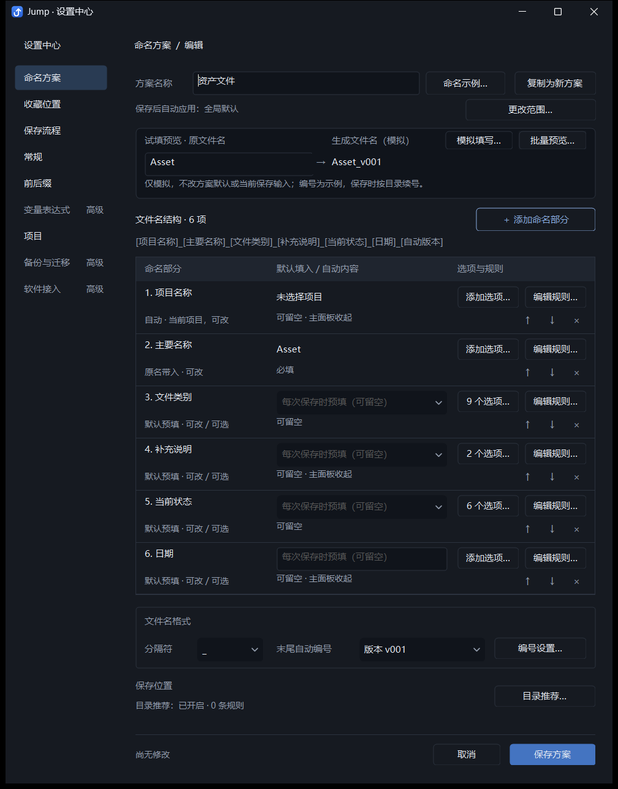
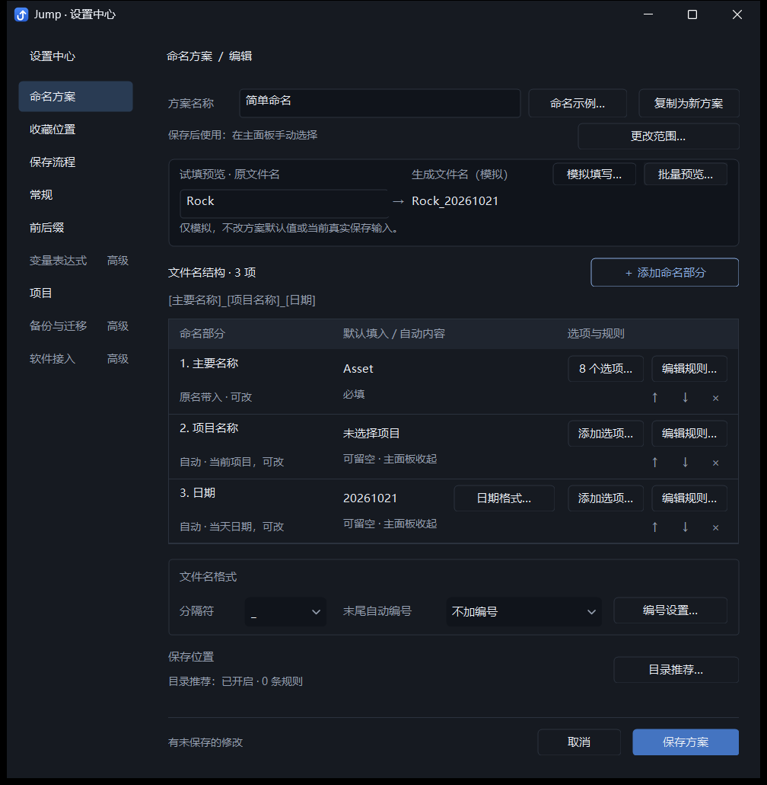
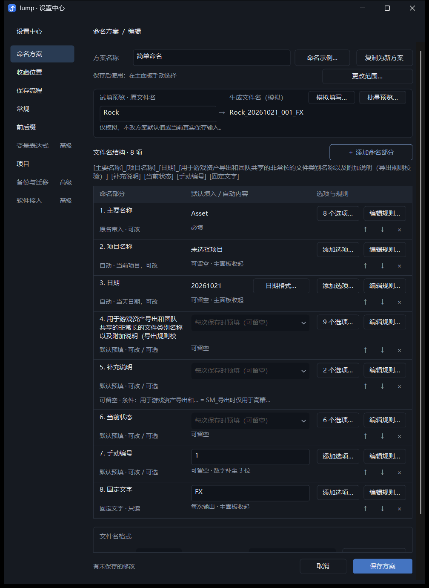
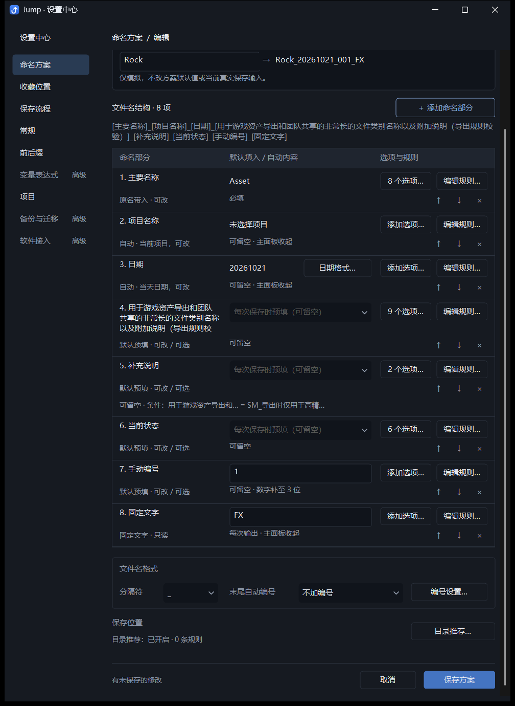
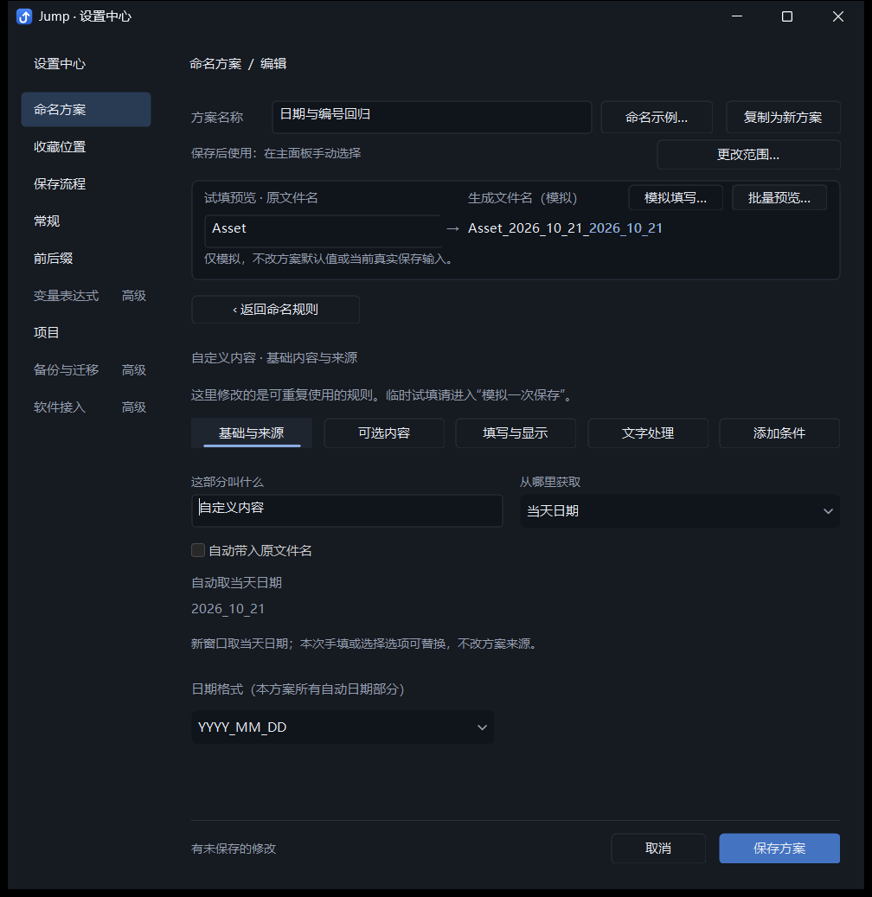
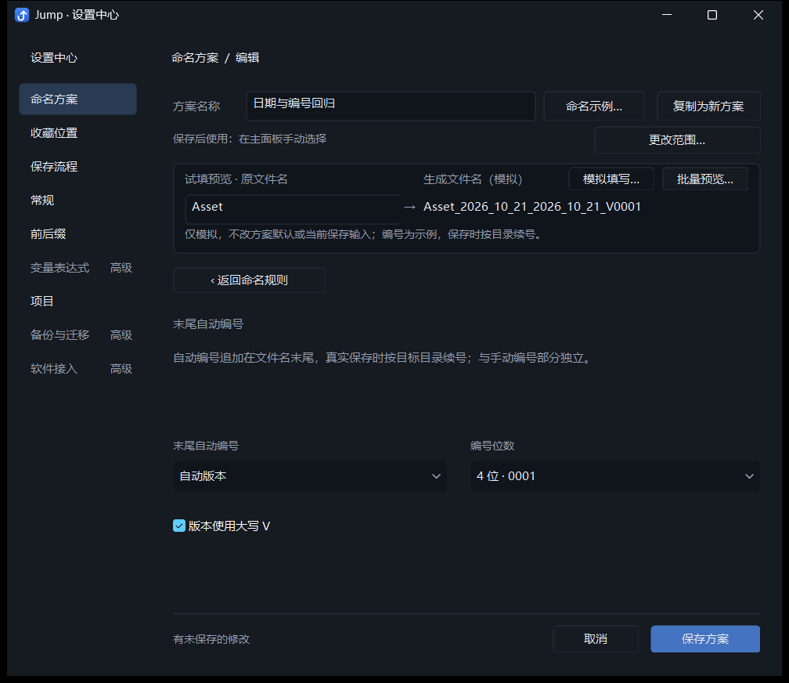

# Jump 命名方案编辑器：精细化 UX 调整

本轮在原有深色表格布局内调整来源表达、操作归属和控件密度，没有新增主导航或修改配置格式。截图来自隔离配置下的实际开发版窗口。

## 内容来源与优先关系

核对了 `namingSession`、`fieldValue`、`applyStructuredValue` 和 `liveStructuredInput`：

| 方案来源 | 新保存窗口的内容 | 保存时手动输入或选择选项 |
| --- | --- | --- |
| 默认预填 | 方案默认值，可以为空 | 替换本次内容，不改方案默认 |
| 原名带入 | 保存窗口原文件名 | 替换本次内容，不改原名映射 |
| 当前项目 | 当前项目名称；未选项目时为空 | 替换本次内容，不改方案来源 |
| 当天日期 | 按方案日期格式生成当天日期 | 替换本次内容，不改方案来源 |
| 固定文字 | 方案固定文字 | 只读；已存选项仍保留，切换来源后可用 |

常用选项是保存时可选的内容库，不会因为存在而自动选中或成为默认值。编辑器中间列修改的是方案默认值；顶部的试填、模拟填写和批量预览使用独立临时输入。条件显示、必填、文字处理、临时省略和主面板可见性沿用原有行为。

来源标签现在同时显示默认行为，例如“原名带入 · 可改”“自动 · 当前项目，可改”“默认预填 · 可改 / 可选”“固定文字 · 只读”。固定文字的状态改为“每次输出”，避免与“可留空”冲突。完整优先关系可在来源、内容表头和选项入口悬停查看；页面没有新增常驻说明段。

## 操作归属与布局

- **方案信息**：复制为新方案与命名示例位于名称旁；软件关联和全局默认继续通过更改范围进入。
- **生成预览**：批量预览与模拟填写并列。缩短预览上下间距，仍实时生成文件名并保留模拟边界提示。
- **文件名结构**：常规行从约 80 个逻辑像素收紧至约 68；长名称及复杂条件按内容增高。选项、规则、上下移动和删除均直接可见。
- **日期**：自动日期行提供日期格式直达入口，定位到该部分的来源页。日期格式仍由方案内所有自动日期部分共用；手动日期文字不受影响。内置默认方案的“日期”仍是原有可编辑文字来源，没有擅自改为自动日期。
- **文件名格式**：分隔符和末尾自动编号保持直接可见；编号设置仅包含模式、位数和版本字母大小写。总览下拉同步已配置的实际格式，例如 `V0001`。
- **保存位置**：集中显示目录推荐状态和规则数；进入目录推荐编辑目录规则及保存前同名检查。
- **固定保存区**：沿用已有保存、取消、修改状态及错误修正。无效分隔符直接定位总览中的分隔符输入。

生产命名算法、手动编号、选项名称与输出映射、条件引用同步、目录规则、配置读写、统一草稿、取消行为、软件关联和真实保存主面板未作语义改动。

## 验证

通过 `dev.ps1` 构建 Debug，不打包、不覆盖 `dist`，保留开发配置。相关前台集成检查串行运行：

```powershell
python -X utf8 tests/run_checks.py --foreground --only scheme_tasks_layout_integration.py unified_scheme_integration.py settings_center_integration.py default_schemes_integration.py
```

| 检查 | 通过组数 | 最终报告目录 |
| --- | --- | --- |
| `scheme_tasks_layout_integration.py` | 7 | `tests/output/scheme-task-layout/c72066a638` |
| `unified_scheme_integration.py` | 15 | `tests/output/unified-scheme/ed9dde32d3` |
| `settings_center_integration.py` | 8 | `tests/output/settings-center/8d1de5afd7` |
| `default_schemes_integration.py` | 3 | `tests/output/default-schemes/9fd64a546d` |

共 33 组全部通过；开发配置 SHA256 与修改前一致。

新增验证包括操作区域归属、日期行直达与焦点、多个日期部分共用格式、切换来源保留日期设置、编号位数和大小写反馈、保存位置开关保存后重新打开、无效分隔符定位。已有检查继续覆盖默认值与试填隔离、撤回修改状态、选项改名同步、统一保存取消、软件默认、保存重启、真实文件保存、长名称、复杂条件、小窗口与 100% / 150% / 200% / 本机 DPI。DPI 检查使用真实窗口处理 DPI 变化消息，未进行物理跨显示器拖动或新用户耗时测试。

## 实际截图

### 内置默认方案“资产文件”



### 三个命名部分



### 八个命名部分：长名称与条件





### 日期与编号分别设置




