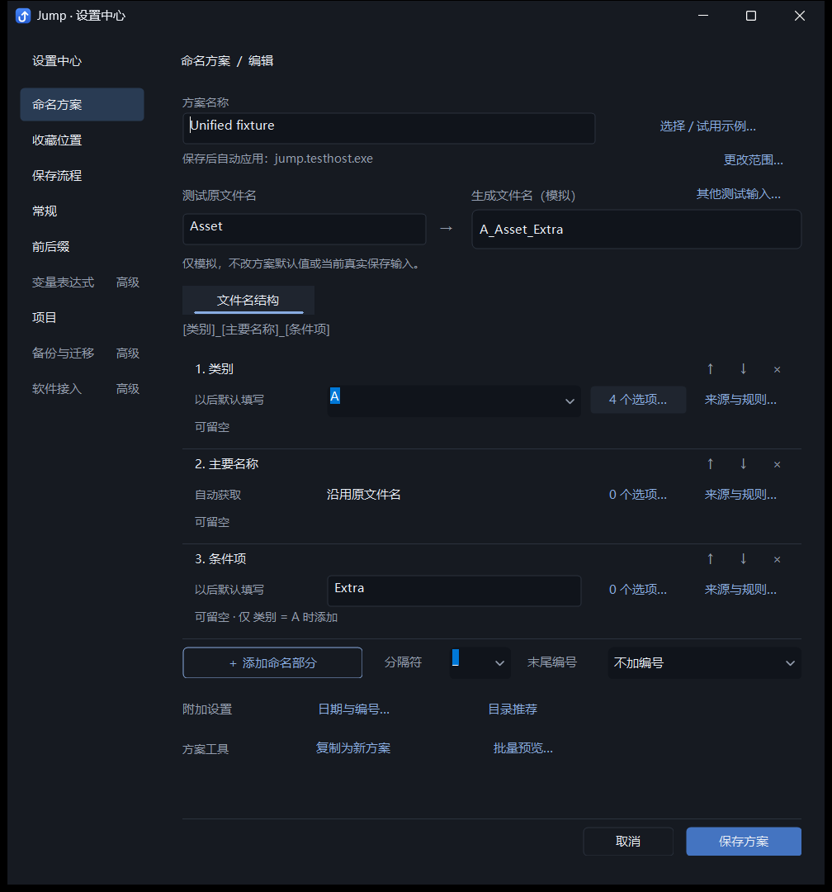
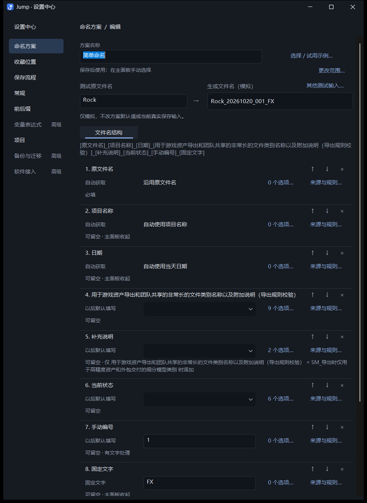
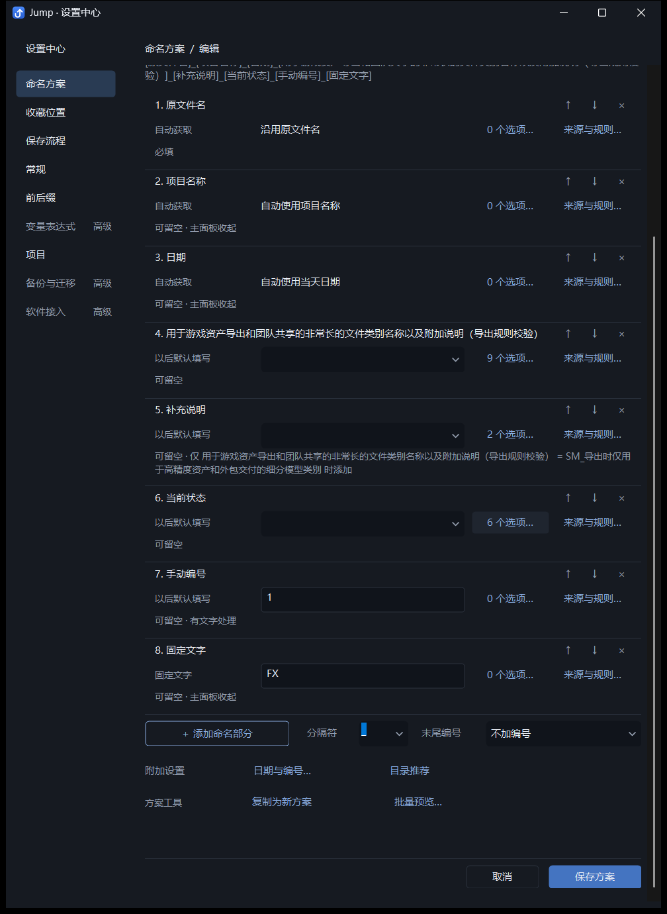
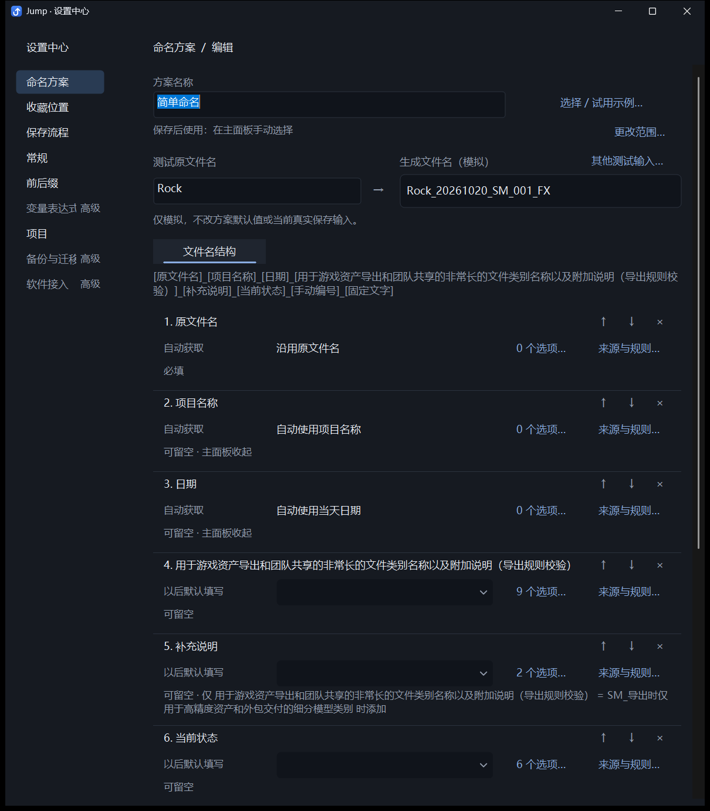
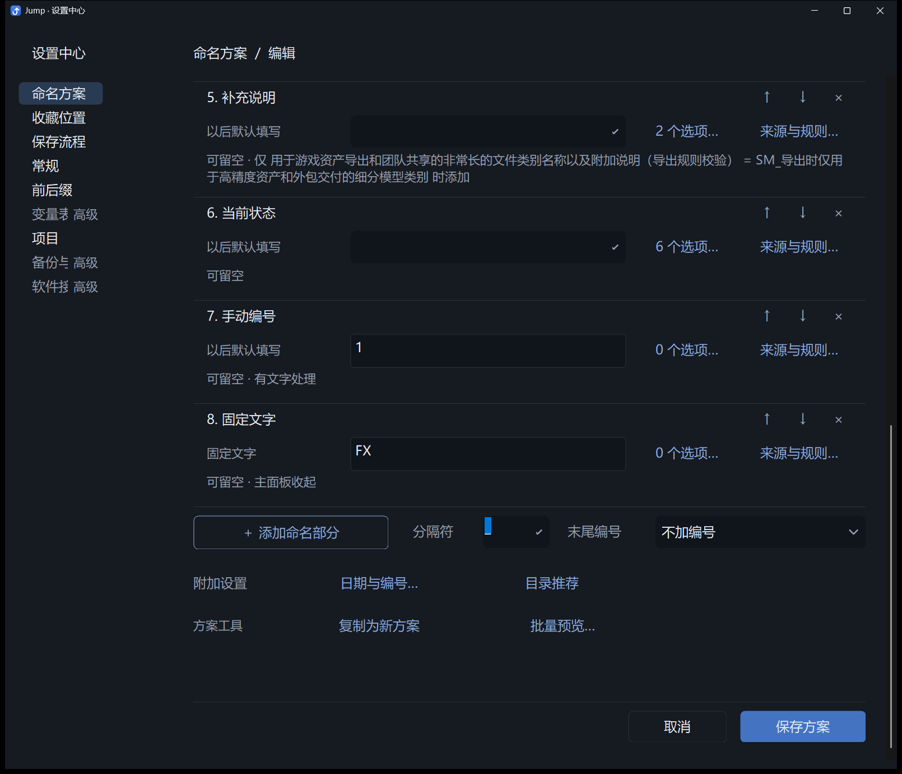
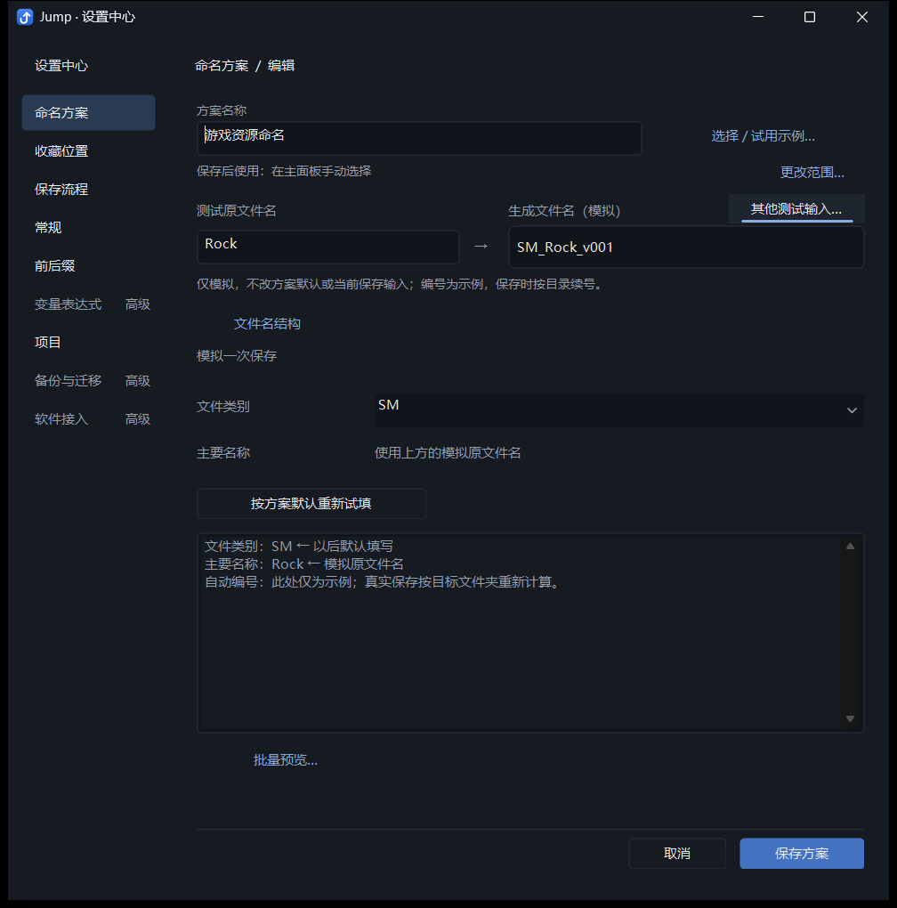
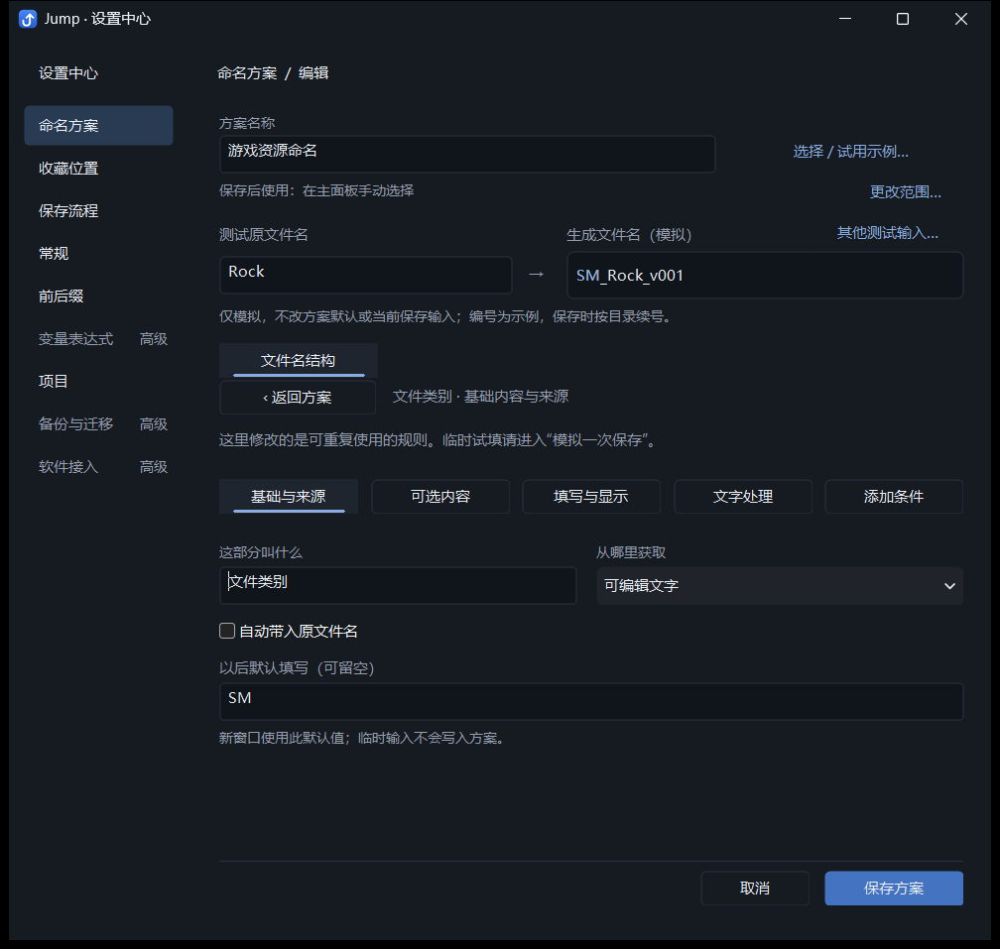
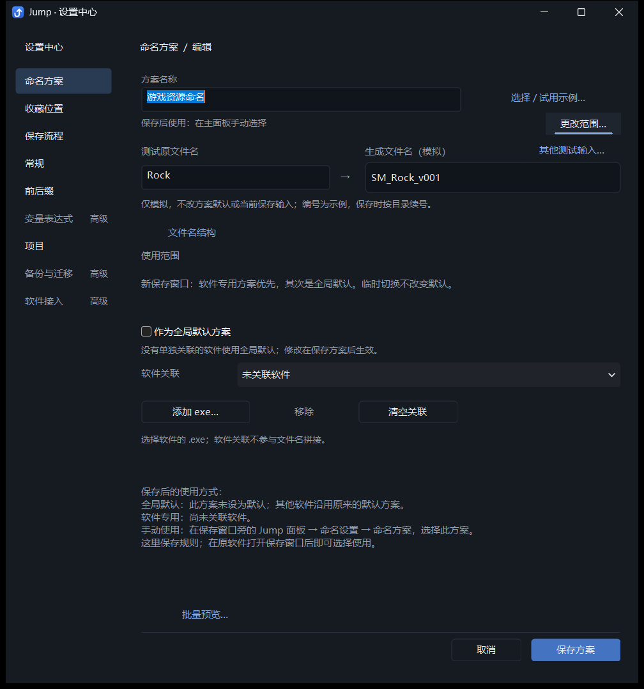
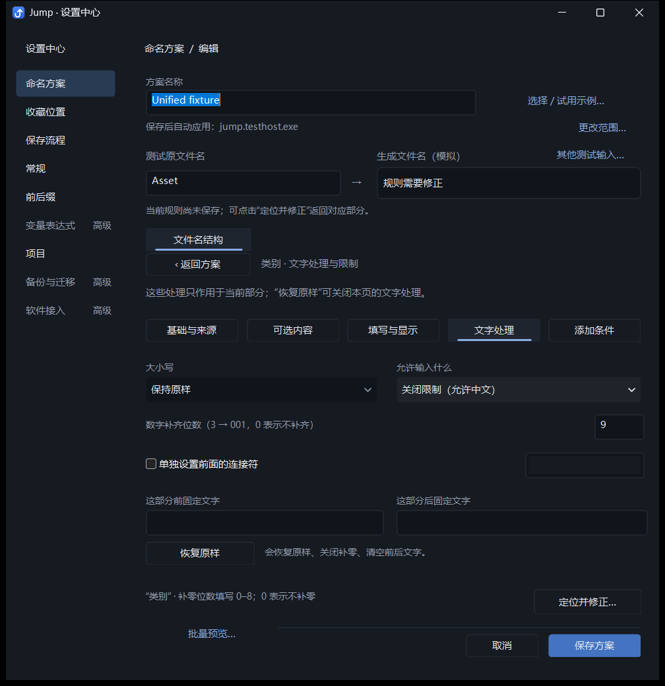

# Jump 命名方案编辑器：视觉层级与操作布局优化

日期：2026-10-20。本页记录在上一轮功能整合之上的实际界面调整，附最终开发版截图。没有增加功能或页面，没有改变命名模型、持久化格式或保存算法。

## 本轮调整

页面现在按“方案信息 → 生成预览 → 文件名结构 → 附加设置 → 保存操作”组织。

方案信息区直接显示保存后会自动应用到哪个软件、作为全局默认，还是需要从主面板手动选择；旁边固定放置“更改范围…”入口。关联和默认优先级仍使用原来的语义，修改一起保存或取消。

预览改为“测试原文件名 → 生成文件名（模拟）”，可在规则页直接试填。结果框由原来约 70 个逻辑像素高缩为 38 个逻辑像素高，并将测试输入放在旁边；整组仍包含标签和必要的边界说明。其他类别等模拟值和逐项输出解释通过原有模拟页的“其他测试输入…”进入。临时输入不修改方案默认值或真实保存会话，编号仍明确标为示例。

每个命名部分使用对齐的三行和细分隔线：名称与排序操作；来源、默认内容、选项数量与规则入口；必填、停用、条件及文字处理状态。名称和复杂摘要根据字体测量分配高度，保留完整内容的悬停说明。长名称最多分配两行，摘要最多两行，组成概览最多三行，避免单项占满窗口；超长内容仍可从对应详情及提示查看。输入框、自动来源说明在同一位置互斥显示。

“添加命名部分”使用强调边框，分隔符和末尾编号留在结构编辑区。日期与编号、目录推荐归入“附加设置”；复制与批量预览归入“方案工具”。这些入口与排序、规则操作使用较轻的文字按钮，保存保留主要填色按钮。取消和保存之前有分隔线。

三至八项沿用相同的可操作尺寸，以滚动容纳更多部分。窗口缩小后的键盘焦点与错误修正仍会将目标输入滚到可见位置。

## 保留的功能

来源、默认内容、显示名称和写入文字分离的常用选项、关键词和颜色、条件及循环校验、文字处理、手动与末尾自动编号、日期、目录推荐、全局默认与软件关联、模板独立草稿、复制边界、批量预览、统一保存取消，以及真实主面板的本次内容和临时修饰继续保留。可参照上一轮文档的 20 项功能对照；本轮只调整入口文案、布局、绘制及与此相关的控件显示和焦点次序。

主要代码：`src/naming_designer.h`、`src/naming_designer_layout.h`、`src/naming_designer_preview.h`。测试扩展位于 `tests/scheme_tasks_layout_integration.py`；README 已更新实际入口说明。

## 验证结果

通过 `dev.ps1 -Mode Background` 构建 Debug，测试前停止开发实例，所有 UI 测试串行运行。

```powershell
python -X utf8 tests/run_checks.py --foreground --only unified_scheme_integration.py settings_center_integration.py default_schemes_integration.py
python -X utf8 tests/scheme_tasks_layout_integration.py
```

| 检查 | 最终报告目录 | 结果 |
| --- | --- | --- |
| 方案集成 | `tests/output/unified-scheme/73927b31df` | 14 组通过 |
| 设置中心 | `tests/output/settings-center/fe8f21855c` | 8 组通过 |
| 软件与全局默认 | `tests/output/default-schemes/a3f0a72110` | 3 组通过 |
| 多部分与 DPI 布局 | `tests/output/scheme-task-layout/f24a79acf2` | 5 组通过 |

布局检查增加了三项和八项的控件边界与操作目标重叠检查、长名称及实际换行的条件摘要、规则页直接试原名、100% / 150% / 200% / 本机比例的 DPI 变化消息。原有模拟隔离、Tab 顺序、缩小视口、错误定位保留输入、取消不写配置等断言继续执行。

方案集成再次验证模板采用、引用同步、默认值隔离、保存和重启、真实主面板临时内容保留，并通过项目自有原生保存对话框实际写出 `SM_Rock_v001.txt` 和 `AZ-Rock-Extra.txt`。

开发配置 `build/dev/settings.ini` 的 SHA256 保持 `9298186A918885BCE9B49CD7206B8BBF36F7B8F837DA33EFC327E359CB9FA769`，没有打包或覆盖 `dist`。最终报告副本、截图来源和代码校验和见 [证据清单](naming-editor-visual-evidence-2026-10-20.json)。

高 DPI 截图由真实开发版窗口响应 DPI 变化消息生成。尚未进行物理跨显示器拖动与真实新用户可用性测试；本轮通过证明布局和行为回归正常，不证明新用户完成任务的耗时已经达标。

## 实际截图

以下截图使用测试配置，不包含用户业务数据。多部分画面分别展示顶部和滚动后的底部，便于检查完整操作区。

### 三个命名部分：类别、主要名称、条件内容



### 八个命名部分：长名称和条件摘要





### 150% 与 200% DPI





### 模拟、来源详情、使用范围与错误状态








