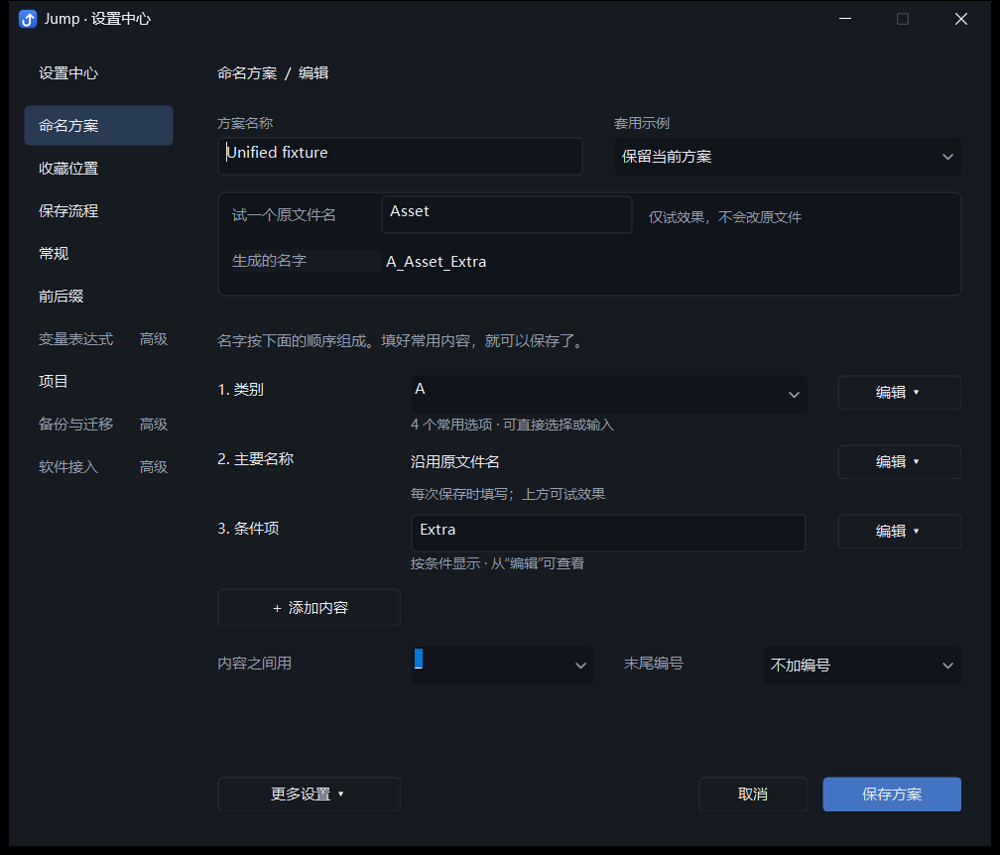
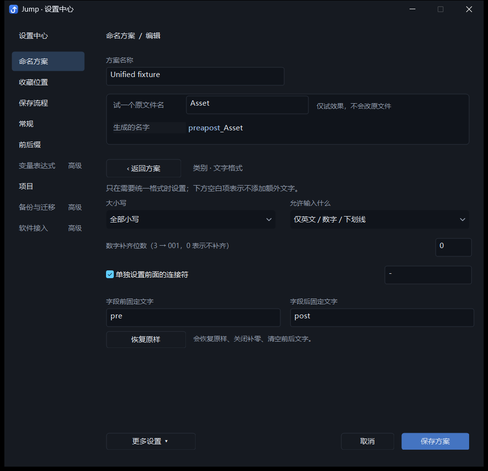
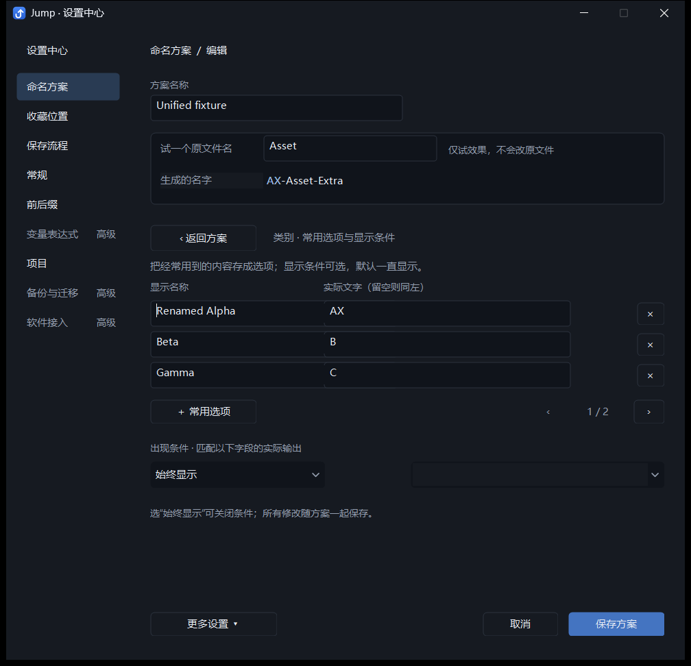
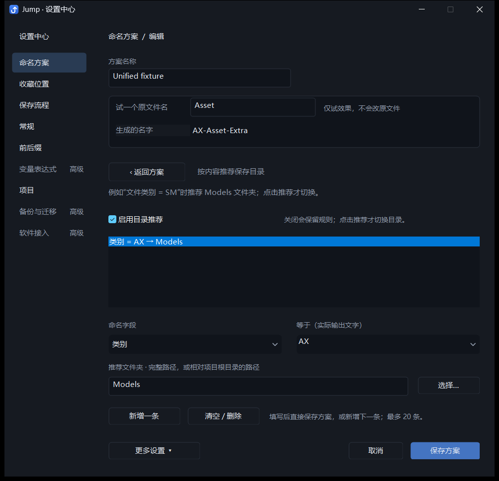
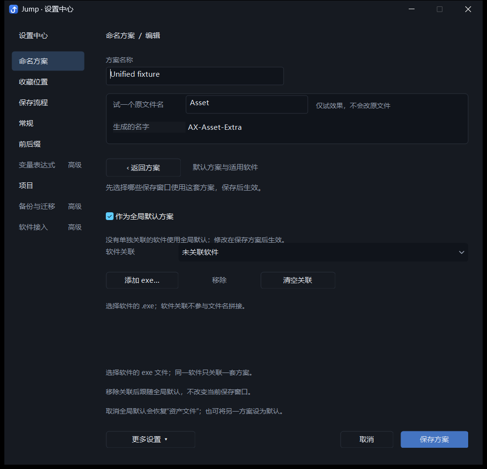

# Jump 命名方案设置：当前实现与体验评审材料

更新日期：2026-10-20。本文描述已经实现的开发版，不代表经过新用户测试的最终设计。

本文面向参与产品、交互或实现评审的 AI 和开发者。可以把全文连同同目录下的截图一起提供给其他 AI；无需先阅读源码。

## 1. 希望评审解决的问题

用户的反馈是：方案相关设置和自定义分散在不同窗口，统一之后依然过于繁复，新用户难以理解。目标是**在保留现有功能的前提下，降低第一次使用和日常修改的理解成本**。

请评审当前实现，不必沿用现有布局。优先回答：

1. 新用户能否知道怎样创建一个能用的命名方案，并理解保存后的效果？
2. 当前设计是否只是把复杂选项藏进菜单？哪些地方仍需要重构？
3. 如何区分“设置方案默认值”和“为这一次保存填写内容”？
4. 高级能力应放在哪里，才能既不干扰入门，又容易找到？
5. 哪些优化最值得先做，哪些需要真实用户测试才能决定？

建议输出：最严重的 3～5 个问题、各自对应的具体改法、一份改进后的页面结构，以及功能保留对照。请将已知事实和推测分开，避免把“控件更少”直接等同于“更容易用”。

## 2. 产品背景和使用场景

Jump 是 Windows 桌面保存辅助工具，会配合原软件的文件保存对话框使用。它把多个命名内容按规则组合成文件名，帮助用户选择保存位置，并将结果回填到原软件。

典型场景：美术资源、游戏资产、贴图、工作文件等需要一致的命名规范。例如用户选择类别“静态模型”，输入名称“Rock”，得到 `SM_Rock_v001`。这只是能力示例，不是所有方案的固定格式。

需要区分两个操作环境：

| 环境 | 用户在做什么 | 主要结果 |
| --- | --- | --- |
| 保存窗口旁的 Jump 主面板 | 填写这次文件的名称、类别、状态等，查看最终文件名 | 回填本次保存使用的文件名 |
| 设置中心中的命名方案编辑器 | 定义以后怎么命名、提供哪些常用选项、采用什么默认规则 | 保存可重复使用的方案 |

最终文件的格式、实际写入和覆盖确认仍由原软件负责。编辑方案或试预览本身不会保存工作文件。

技术环境为原生 C++ / Win32 桌面应用，已有深色主题、菜单和表单体系。评审可以建议调整信息架构，不需要被当前控件划分限制；实施成本可另行标注。

## 3. 本轮调整的范围

前一版已把命名字段、常用选项、格式、目录推荐、默认方案和软件关联集中到设置中心中的同一编辑器，并统一保存和取消。但编辑器仍有多层标签和较多同时出现的规则控件。

本轮已改为：默认显示一页概要，复杂规则按任务进入详情。常用操作直接完成，详情共享同一份草稿。

本轮主要调整命名方案编辑器。整个设置中心仍有收藏位置、保存流程、常规、前后缀、变量表达式、项目、备份与迁移、软件接入等栏目，并未把全应用所有设置都合并进方案。方案设置中可定义局部前后固定文字，主面板也有本次命名的临时修饰；这些概念仍可能造成理解负担。

## 4. 当前入口与页面结构

### 4.1 入口

- 设置中心 → 命名方案 → 选中方案 → 方案设置。
- 保存主面板 → 命名设置 → 方案设置。
- 主面板中的“编辑常用选项”直接定位到同一个编辑器的对应内容详情。
- 设置中心的“软件关联与默认”直接定位到同一编辑器的对应详情。

外部入口有多个，但方案编辑使用同一个设置中心和同一套草稿逻辑。文件选择和必要的确认仍使用原生对话框。

### 4.2 默认页：从上到下

| 区域 | 当前显示或操作 | 目的 |
| --- | --- | --- |
| 方案身份 | 方案名称；“套用示例”下拉框 | 命名方案，或从接近需求的示例起步 |
| 效果预览 | “试一个原文件名”输入框；“生成的名字” | 输入原名，立即查看组合结果 |
| 简短说明 | “名字按下面的顺序组成。填好常用内容，就可以保存了。” | 说明组合顺序和基本操作 |
| 命名内容列表 | 按顺序显示每项名称、可填的默认内容或自动来源说明、状态摘要、右侧“编辑 ▾” | 直接理解名字由什么组成 |
| 添加 | “＋ 添加内容” | 加入另一部分 |
| 常用整体规则 | “内容之间用”分隔符；“末尾编号” | 在默认页完成常见格式调整 |
| 底部操作 | “更多设置 ▾”、取消、保存方案 | 进入其他任务，或统一提交修改 |

默认页不再显示原先的多层标签导航和字段规则侧栏。内容较多时可滚动。

### 4.3 每项内容怎么显示

- 可编辑文字：直接填写新保存窗口使用的默认内容。
- 有常用选项的内容：可从下拉框选择，也可直接输入。
- 沿用原文件名、当前项目名称、当天日期：显示自动来源的说明。
- 固定文字：直接填写每次输出的文字。
- 已有特殊文字格式、显示条件、停用或必填状态：在该项下方显示简短提示，完整规则从“编辑”进入。

顶部原文件名输入框只用于试效果，不改变方案默认内容。自动带入原文件名的接收项在实际保存时获得当前文件的原名，每个方案最多指定一项。

### 4.4 每项右侧的“编辑 ▾”

| 菜单项 | 进入后的能力 |
| --- | --- |
| 名称和填写方式… | 名称、内容来源、自动带入原文件名、启用此项、默认值、必填、在主面板显示 |
| 常用选项… | 编辑选项的显示名称与实际输出文字、添加删除、翻页 |
| 文字格式… | 大小写、输入限制、数字补零、单独连接符、前后固定文字、恢复原样 |
| 什么时候显示… | 设置依赖另一项实际输出的显示条件 |
| 往前移 / 往后移 | 调整组合顺序，首尾位置的无效操作禁用 |
| 删除这部分 | 删除内容及相关引用，至少保留一项 |

“常用选项”和“什么时候显示”目前进入同一个详情页，只是初始焦点不同；页面同时包含选项编辑区和条件区。两项并未实现为完全独立的任务页。

### 4.5 “更多设置 ▾”

| 菜单项 | 包含的内容 |
| --- | --- |
| 连接、日期与编号… | 全局分隔符、日期格式、自动编号类型、编号位数、版本字母大小写、保存前同名检查 |
| 按内容推荐保存目录… | 推荐开关、字段与实际输出的匹配规则、目标目录 |
| 默认方案与适用软件… | 全局默认方案开关、关联或移除软件 exe |
| 用多个文件名试效果… | 用多行原文件名比较生成结果、组成和规则错误 |
| 复制为新方案 | 保留命名规则和目录推荐，创建新方案草稿 |

详情有明确的“‹ 返回方案”，继续使用相同预览和保存 / 取消操作。返回时保留修改，不需要分段保存。

## 5. 当前实际界面截图

以下截图来自同一开发版本的自动化测试方案，内容是构造的测试数据，不是用户的真实业务方案。图中 `Unified fixture`、`A`、`Extra` 等用于覆盖已有条件与规则。

### 默认页：三部分组成文件名

第一项有常用选项，第二项沿用原文件名，第三项有显示条件。图中可以看到条件摘要，而不是直接展开所有条件控件。

### 文字格式详情

该页保留高级规则，供按需调整。其控件数量、术语和分组仍值得评审。

### 常用选项与显示条件详情

### 目录推荐详情

### 默认方案与适用软件详情

## 6. 典型操作流程

### A. 从示例建立命名方案

1. 新建或打开方案，选择接近需求的示例。
2. 试填原文件名，查看生成结果。
3. 调整内容的默认值，添加或删除不需要的部分，调整顺序。
4. 选择分隔符和是否添加末尾编号。
5. 保存方案。需要自动应用时，再设置全局默认或软件关联。

示例下拉框中有“保留当前方案”。在示例之间来回切换，会保留各自草稿；返回此项可回到原方案草稿。这是当前实现行为，不代表新用户一定能理解其含义。

### B. 修改某项的实际输出

例如希望用户选择“静态模型”但文件名输出 `SM`：

1. 在“文件类别”右侧进入“编辑 → 常用选项”。
2. 显示名称填“静态模型”，实际文字填 `SM`；实际文字留空时按显示名称输出。
3. 返回方案，查看结果，再保存。

### C. 设置只在某类别下出现的内容

例如“贴图用途”只在文件类别实际输出为 `T` 时出现：

1. 在“贴图用途”右侧进入“编辑 → 什么时候显示”。
2. 选择依赖项“文件类别”，匹配实际输出 `T`。
3. 返回方案并保存；不满足条件时，该项不输出，也不参与必填校验。

### D. 根据内容推荐目录

在“更多设置 → 按内容推荐保存目录”中，设置如“文件类别输出 `SM` → 推荐 `Models`”。支持完整路径或相对项目根目录的路径。实际使用时，用户点击推荐才切换目录，不会仅因规则匹配自动提交保存。

### E. 为某软件自动应用方案

进入“更多设置 → 默认方案与适用软件”，选择软件 exe 并保存。新保存窗口优先采用软件关联方案；没有关联时采用全局默认。临时切换方案不改变默认设置。

## 7. 必须保留的功能及语义

| 能力 | 当前行为与边界 |
| --- | --- |
| 命名内容种类 | 主要名称、项目名称、日期、文件类别、补充说明、当前状态、手动编号、固定文字、自定义内容 |
| 数量与顺序 | 最多 8 项，至少保留 1 项；固定文字和自定义内容可有多项；已有同类项可定位编辑 |
| 默认与自动来源 | 支持可编辑文字、原文件名、项目、日期和固定文字；原名接收项最多一个 |
| 常用选项 | 显示名称与实际输出可不同；支持添加、删除、翻页；保存时检查重复和无效文字；保留已有关键词与颜色 |
| 局部文字规则 | 大小写、允许字符、补零、独立连接符、前后固定文字；可一次恢复原样 |
| 启用与面板可见性 | “启用此项”控制是否参与命名；“在主面板显示”只控制常用输入是否显示，仍可参与命名 |
| 显示条件 | 依赖另一项的实际输出；隐藏项不输出、不校验必填；循环依赖提示修正 |
| 全局格式 | 分隔符、日期格式、末尾自动版本或序号、位数、版本字母大小写 |
| 两种编号 | 内容中的“手动编号”由用户填写；末尾自动编号按实际保存目录计算，二者独立 |
| 同名提示 | 可开关；检查精确目标文件属性；原软件仍负责覆盖确认 |
| 目录推荐 | 最多 20 条；支持项目相对路径；关闭推荐保留规则；由用户点击采用 |
| 自动应用 | 全局默认 + 按软件关联；软件按 exe 文件名识别，不区分大小写 |
| 复制 | 保留规则及目录推荐，不继承全局默认身份和软件关联 |
| 预览 | 单个原名即时预览，另有多原名试效果；预览不扫描实际保存目录，自动编号以保存时计算为准 |
| 一致性维护 | 选项实际输出改名后同步相关默认值、显示条件和目录规则；删除内容清理相关引用 |
| 草稿事务 | 各详情共享一次保存 / 取消；切换示例保留各自草稿；取消不写配置 |
| 对本次保存的影响 | 保存方案时保留本次已填内容和临时修饰；仍沿用旧默认的项采用新默认，来源变更则使用新规则 |

优化可以改变入口、步骤、术语或实现方式，不要求保留当前控件。上表中的能力与行为应被明确迁移，避免为了简洁直接删掉已有用途。

## 8. 当前设计取舍

1. **把默认页组织成名字的组成顺序。** 用户先看见结果，再看每部分；直接输入优先于进入规则页。
2. **复杂规则按需进入。** 通过每项的编辑菜单和更多设置，减少同时出现的控件。
3. **沿用同一草稿。** 详情只改变当前编辑任务，不引入多次独立提交。
4. **已有复杂规则只显示摘要。** 避免重开旧方案时强迫用户阅读所有规则，同时提醒方案并非只有表面上的值。
5. **保留直接定位入口。** 熟悉功能的用户可从主面板进入对应任务。

这些是设计意图。其效果目前由实现检查和开发者观察支持，尚无真实新用户测试数据。

## 9. 仍需重点评审的问题

以下是待验证的问题，不是已证明的用户测试结论：

- **默认值与本次填写是否混淆？** 默认页文案“填好常用内容”可能让用户以为是在填当前文件，而不是设置未来窗口的默认值。
- **第一次打开是否缺少方向？** 一个仅含“主要名称”的方案虽然简单，但用户可能不知道什么时候该添加类别、日期或编号，也未必知道保存后如何使用。
- **“套用示例”的结果是否可预测？** 示例之间保留多个草稿、“保留当前方案”以及覆盖当前结构的关系，可能不符合普通下拉框的预期。
- **菜单隐藏了多少成本？** 每项都叫“编辑”，用户可能需要逐一打开才能理解有哪些能力；已配置规则的摘要是否足够具体？
- **任务是否仍混杂？** 常用选项与显示条件仍在一页；“连接、日期与编号”也包含同名检查，分类可能不自然。
- **关键术语是否过多？** 内容、字段、常用选项、实际输出、默认值、内容来源、主面板、全局默认等仍需要理解。
- **规则是否容易解释？** 不输出可能因为空值、条件、停用；用户能否快速定位原因，特别是多项互相依赖时？
- **相似概念是否应重新组织？** 手动编号与自动编号、停用与隐藏主面板、局部固定文字与本次前后缀，可能都需要更清晰的操作语境。
- **空分隔符是否足够直观？** 当前分隔符控件可显示空值，用户能否理解它代表直接连接？
- **默认方案与软件关联是否容易找到？** 放在更多设置能减少干扰，但它决定保存后的实际使用；是否应在保存结果或方案列表中更明显地表达？
- **长方案的可读性如何？** 8 项、长名称、多个复杂条件、较小窗口或高 DPI 下，摘要与滚动是否仍清晰？
- **出错恢复是否顺畅？** 全方案统一校验有利于一致性，但一个不完整的规则可能阻止用户保存其他修改；提示和定位是否足够？

## 10. 已完成的验证与证据边界

已通过开发构建和以下针对性检查：

- `tests/unified_scheme_integration.py`：默认页直接编辑、示例草稿切换、格式详情往返、新增删除、选项及引用同步、统一取消、保存重启、默认与软件关联、错误阻止保存、复制边界、主面板入口，以及原生保存测试宿主的真实文件写入。
- `tests/settings_center_integration.py`：设置中心相关集成流程。
- 开发者对默认页和格式详情做过实际视觉检查。
- 集成测试确认开发用持久配置未被测试夹具改写。

本次记录的完整方案回归报告在 `tests/output/unified-scheme/055e1116f5/report.json`。本文件附图复制自该次测试输出。

这些验证支持“相关行为继续正常工作”，不证明“新用户已经能看懂”。目前没有新用户任务完成率、完成时间、误操作率或访谈数据，也没有覆盖全部软件保存窗口的可用性研究。

建议后续用几项具体任务验证设计：从零建立 `类别_原名_v001`、设置显示名称与缩写、给贴图添加条件内容、为指定软件设默认方案、撤回一次复杂修改。记录用户第一次卡住的位置，并检查用户能否解释保存后的效果。

## 11. 开发者定位

供需要深入实现的评审者参考；仅做产品评审可跳过。

| 文件 | 用途 |
| --- | --- |
| `src/naming_designer.h` | 方案默认页、详情、菜单、草稿读取与预览交互 |
| `README.md` | 当前功能与操作说明 |
| `tests/unified_scheme_integration.py` | 方案统一编辑和简化界面的集成回归 |
| `tests/settings_center_integration.py` | 设置中心集成回归 |

当前实现仍保留部分旧导航控件作为内部兼容结构，但它们在新界面中不可见。评审应以截图和实际可见操作为准，不要把源码中存在的隐藏控件误认为用户仍能看到的导航。
